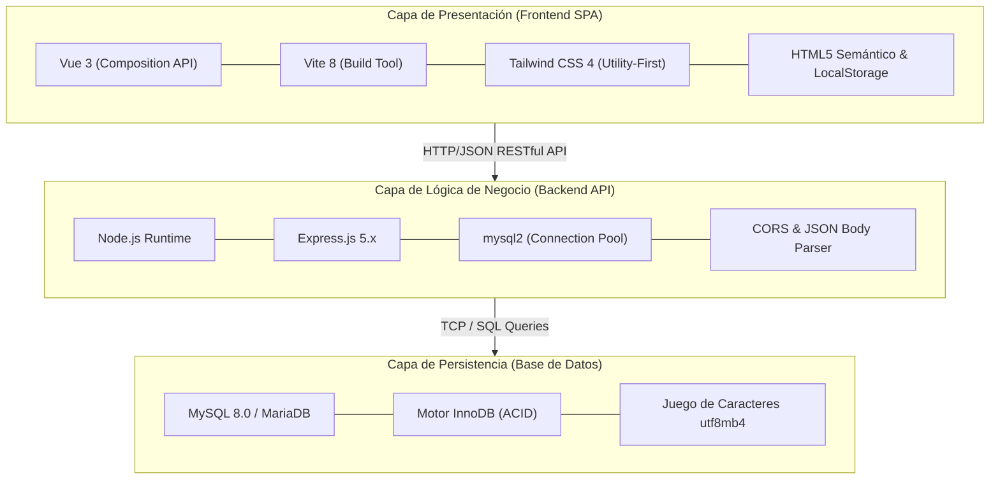
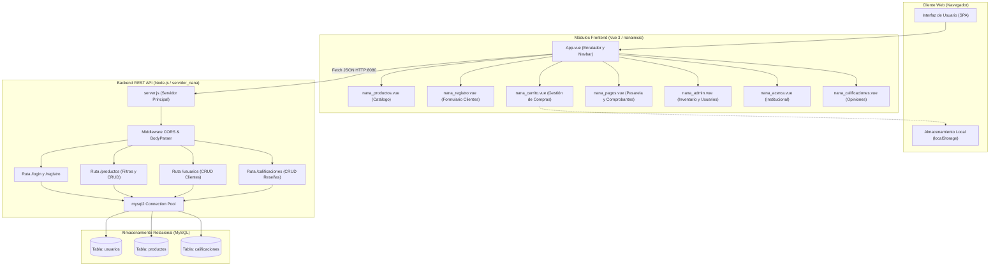
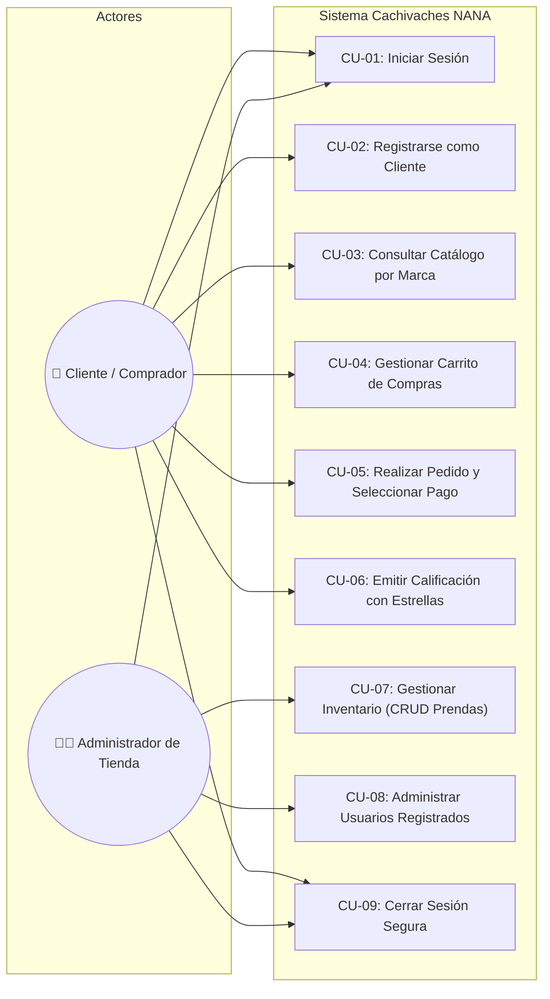
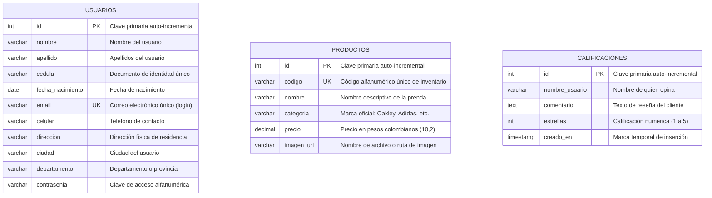

# SERVICIO NACIONAL DE APRENDIZAJE - SENA
## Centro de Formación en Tecnologías de la Información y las Comunicaciones
### Programa: Tecnología en Análisis y Desarrollo de Software (ADSO)

---

# EVIDENCIA DE APRENDIZAJE: GA10-220501097-AA10-EV01
## MANUAL TÉCNICO DEL SISTEMA DE INFORMACIÓN
### Plataforma Web de Comercio Electrónico y Gestión de Inventario *"Cachivaches NANA"*

**Documento elaborado conforme a la:** *Guía para la Elaboración de Manual Técnico y de Operaciones de los Sistemas de Información* (Departamento Nacional de Planeación - DNP)  
**Código del Sistema:** SI-NANA-2026  
**Versión del Documento:** 1.0 — Definitiva  
**Fecha de Emisión:** Octubre de 2026  
**Ubicación del Proyecto:** `C:\Users\User\Documents\SENA TECNOLOGIA\proyecto`  

---

## 1. INFORMACIÓN GENERAL DEL SISTEMA

### 1.1. Identificación y Propósito
El sistema de información **Cachivaches NANA** es una solución web integral desacoplada orientada a la gestión de inventario, consulta multimarca, autenticación de usuarios y procesamiento de pedidos de prendas y accesorios de vestir (*Oakley, Adidas, Victoria's Secret, Puma, Polo, Varios*). Su objetivo principal es optimizar el ciclo comercial de la tienda, reduciendo tiempos de consulta, garantizando la persistencia transaccional y facilitando la administración de inventarios en tiempo real.

### 1.2. Alcance Técnico
El presente manual describe las especificaciones arquitectónicas, dependencias, modelo de datos, componentes de software, scripts de despliegue y procedimientos operativos necesarios para que los ingenieros de soporte, desarrolladores y administradores de base de datos puedan instalar, configurar, mantener y escalar la aplicación.

---

## 2. PRERREQUISITOS DE INSTALACIÓN DEL SISTEMA

Para garantizar el correcto funcionamiento del sistema en ambientes de desarrollo, pruebas o producción, la infraestructura anfitriona debe satisfacer los siguientes requisitos mínimos:

### 2.1. Requisitos de Hardware

| Componente | Requisito Mínimo (Desarrollo) | Requisito Recomendado (Producción / Cloud) |
|---|---|---|
| **Procesador (CPU)** | Intel Core i3 / AMD Ryzen 3 (2 núcleos, 2.0 GHz) | Intel Xeon / AMD EPYC (4 núcleos virtuales vCPU $\ge 2.5\text{ GHz}$) |
| **Memoria RAM** | 4 GB DDR4 | 8 GB DDR4 ECC |
| **Almacenamiento (Disco)** | 10 GB de espacio libre (HDD o SSD) | 40 GB SSD NVMe de alta velocidad |
| **Conectividad de Red** | Tarjeta de red Ethernet o Wi-Fi (10 Mbps) | Conexión simétrica $\ge 100\text{ Mbps}$ con IP pública estática |

### 2.2. Requisitos de Software y Entorno de Ejecución

| Software / Herramienta | Versión Requerida | Propósito en el Sistema |
|---|---|---|
| **Sistema Operativo** | Windows 10/11 64-bit o Linux Ubuntu Server 22.04/24.04 LTS | Plataforma anfitriona para ejecución de servicios. |
| **Node.js Runtime** | Versión LTS 20.19.0 o superior (Verificado v24.16.x) | Motor de ejecución JavaScript para Backend y Vite. |
| **Gestor de Paquetes npm** | Versión 10.x o superior | Instalación y resolución del árbol de dependencias. |
| **Servidor de Base de Datos** | MySQL Server 8.0.x o MariaDB 10.4.x (XAMPP 3.3+) | Motor relacional para almacenamiento transaccional. |
| **Herramienta de BD** | phpMyAdmin 5.2.1 o MySQL Workbench 8.0 | Administración gráfica del esquema `cachivachez_nana_db`. |
| **Navegador Web Cliente** | Google Chrome 110+, Edge 110+, Firefox 115+, Safari 16+ | Renderizado de interfaz Vue 3 con soporte ES Modules. |

### 2.3. Puertos de Red y Reglas de Firewall

| Puerto | Protocolo | Servicio Asignado | Visibilidad |
|---|---|---|---|
| **3306** | TCP | Motor MySQL / MariaDB | Localhost / Red interna de base de datos |
| **8080** | TCP (HTTP) | Servidor Backend Express (`server.js`) | Localhost o expuesto mediante Proxy Inverso |
| **5173** | TCP (HTTP) | Servidor Frontend Vite Development Server | Red de desarrollo (`http://localhost:5173/`) |
| **80 / 443** | TCP (HTTP/S)| Nginx Proxy Inverso (Entorno productivo) | Acceso público a clientes con SSL Let's Encrypt |

---

## 3. FRAMEWORKS, TECNOLOGÍAS Y ESTÁNDARES DE CONSTRUCCIÓN

La plataforma adopta una arquitectura basada en desacoplamiento de capas (*Single Page Application + RESTful API*), aplicando las mejores prácticas y estándares de la industria del software:



### 3.1. Estándares y Patrones de Software Aplicados
1. **Arquitectura REST (Representational State Transfer):** Los recursos (`/productos`, `/usuarios`, `/calificaciones`, `/login`, `/registro`) se comunican mediante métodos HTTP estándar (`GET`, `POST`, `DELETE`, `OPTIONS`) con respuestas serializadas en formato JSON estructurado.
2. **Component-Based Architecture (SFC - Single File Components):** En el frontend, cada módulo (`.vue`) encapsula su lógica (`<script setup>`), vista (`<template>`) y diseño reactivo.
3. **Manejo de Conexiones por Pool (*Connection Pooling*):** Implementación de `mysql.createPool` en `server.js` para reutilización de sockets TCP, evitando fugas de memoria y habilitando reconexión automática.
4. **SemVer (Semantic Versioning):** Versionamiento formal de entregables `MAJOR.MINOR.PATCH`.
5. **Estándares ISO/IEC:** Alineado con **ISO/IEC 25010** (Calidad de Software) e **ISO/IEC 14764** (Procesos de Mantenimiento y Soporte).

---

## 4. DIAGRAMA DE COMPONENTES DEL SISTEMA

El siguiente diagrama UML modela la interacción entre los componentes lógicos del frontend, servicios backend, middlewares y repositorios de datos:



---

## 5. DIAGRAMA Y ESPECIFICACIÓN DE CASOS DE USO

### 5.1. Diagrama de Casos de Uso (UML)



### 5.2. Especificación Detallada de Casos de Uso Principales

#### Caso de Uso CU-03: Consultar Catálogo por Marca
* **Actor:** Cliente / Comprador.
* **Precondición:** El servidor backend y frontend deben encontrarse en ejecución.
* **Flujo Principal:**
  1. El cliente accede a la pestaña *"Productos"* desde la barra de navegación superior.
  2. El sistema carga el catálogo predeterminado desde la base de datos MySQL.
  3. El cliente hace clic en el botón de una marca específica (*Oakley, Adidas, Victoria Secret, Puma, Polo, Varios*).
  4. El sistema ejecuta una petición reactiva filtrando los resultados de acuerdo con la categoría seleccionada.
  5. El cliente visualiza las tarjetas de prendas con código, nombre, selectores de talla/color y precio en moneda colombiana.
* **Flujo Alternativo:** Si la búsqueda textual no arroja coincidencias, se despliega una interfaz vacía con la opción de limpiar filtros.

#### Caso de Uso CU-07: Gestionar Inventario de Prendas (Administrador)
* **Actor:** Administrador de la Tienda.
* **Precondición:** Acceso autorizado al módulo `/admin`.
* **Flujo Principal:**
  1. El administrador ingresa a *"Administrador"* en la barra superior.
  2. En la pestaña *"Inventario de Prendas"*, digita el código, nombre, selecciona la marca oficial en el menú desplegable, precio e imagen.
  3. Presiona *"Subir al Catálogo"*.
  4. El backend inserta el registro en la tabla `productos` de MySQL.
  5. La tabla de inventario se refresca inmediatamente mostrando la nueva prenda con su botón de eliminación.

---

## 6. MODELO ENTIDAD-RELACIÓN (MER / DER) DE LA BASE DE DATOS

La base de datos relacional `cachivachez_nana_db` opera bajo el motor transaccional **InnoDB**, garantizando propiedades ACID (Atomicidad, Consistencia, Aislamiento y Durabilidad).



---

## 7. DICCIONARIO DE DATOS

A continuación se detalla la especificación formal campo a campo de cada tabla del esquema `cachivachez_nana_db`.

### 7.1. Tabla: `usuarios`
* **Descripción:** Almacena los registros de los clientes registrados y administradores de la plataforma.
* **Motor:** InnoDB \| **Cotejamiento:** `utf8mb4_unicode_ci`

| Campo | Tipo de Dato | Longitud / Formato | Nulo | Llave | Valor por Defecto | Descripción |
|---|---|---|:---:|:---:|---|---|
| `id` | `INT` | 11 dígitos | NO | **PK** | AUTO_INCREMENT | Identificador único y secuencial del usuario. |
| `nombre` | `VARCHAR` | 100 caracteres | SÍ | — | NULL | Nombre de pila del usuario. |
| `apellido` | `VARCHAR` | 100 caracteres | SÍ | — | NULL | Apellidos del usuario. |
| `cedula` | `VARCHAR` | 20 caracteres | SÍ | — | NULL | Número de identificación ciudadana. |
| `fecha_nacimiento`| `DATE` | AAAA-MM-DD | SÍ | — | NULL | Fecha de natalicio del usuario. |
| `email` | `VARCHAR` | 100 caracteres | SÍ | **UK** | NULL | Correo electrónico único utilizado para login. |
| `celular` | `VARCHAR` | 20 caracteres | SÍ | — | NULL | Número telefónico móvil o WhatsApp. |
| `direccion` | `VARCHAR` | 255 caracteres | SÍ | — | NULL | Dirección física de correspondencia / entrega. |
| `ciudad` | `VARCHAR` | 100 caracteres | SÍ | — | NULL | Ciudad de residencia (ej. Bello, Bogotá). |
| `departamento` | `VARCHAR` | 100 caracteres | SÍ | — | NULL | Departamento o región (ej. Antioquia). |
| `contrasenia` | `VARCHAR` | 255 caracteres | SÍ | — | NULL | Contraseña de autenticación del usuario. |

---

### 7.2. Tabla: `productos`
* **Descripción:** Catálogo maestro de inventario clasificado por marcas oficiales.
* **Motor:** InnoDB \| **Cotejamiento:** `utf8mb4_unicode_ci`

| Campo | Tipo de Dato | Longitud / Formato | Nulo | Llave | Valor por Defecto | Descripción |
|---|---|---|:---:|:---:|---|---|
| `id` | `INT` | 11 dígitos | NO | **PK** | AUTO_INCREMENT | Identificador numérico único de la prenda. |
| `codigo` | `VARCHAR` | 50 caracteres | SÍ | **UK** | NULL | Código comercial único (ej. `OAK-001`, `ADI-001`). |
| `nombre` | `VARCHAR` | 100 caracteres | SÍ | — | NULL | Nombre comercial descriptivo de la prenda. |
| `categoria` | `VARCHAR` | 100 caracteres | SÍ | — | NULL | Marca oficial (*Oakley, Adidas, Puma, etc.*). |
| `precio` | `DECIMAL` | 10 enteros, 2 decimales | SÍ | — | NULL | Valor comercial en Pesos Colombianos (COP). |
| `imagen_url` | `VARCHAR` | 255 caracteres | SÍ | — | NULL | Nombre de archivo de imagen alojado en assets. |

---

### 7.3. Tabla: `calificaciones`
* **Descripción:** Registro histórico de valoraciones y comentarios de clientes.
* **Motor:** InnoDB \| **Cotejamiento:** `utf8mb4_unicode_ci`

| Campo | Tipo de Dato | Longitud / Formato | Nulo | Llave | Valor por Defecto | Descripción |
|---|---|---|:---:|:---:|---|---|
| `id` | `INT` | 11 dígitos | NO | **PK** | AUTO_INCREMENT | Identificador único de la reseña. |
| `nombre_usuario` | `VARCHAR` | 100 caracteres | SÍ | — | NULL | Nombre de la persona que realiza la valoración. |
| `comentario` | `TEXT` | Texto variable | SÍ | — | NULL | Opinión cualitativa sobre el servicio o producto. |
| `estrellas` | `INT` | 11 dígitos (1 a 5) | SÍ | — | NULL | Puntuación cuantitativa en escala de 1 a 5. |
| `creado_en` | `TIMESTAMP` | Marca temporal | NO | — | `CURRENT_TIMESTAMP` | Fecha y hora exacta de registro de la reseña. |

---

## 8. SCRIPTS DE INSTALACIÓN, CONFIGURACIÓN Y DESPLIEGUE

### 8.1. Script DDL/DML Completo de Base de Datos (`database.sql`)
Ejecutar este script en phpMyAdmin o consola MySQL para inicializar el esquema y los datos maestros:

```sql
-- 1. CREACIÓN DE LA BASE DE DATOS
CREATE DATABASE IF NOT EXISTS `cachivachez_nana_db` 
CHARACTER SET utf8mb4 
COLLATE utf8mb4_unicode_ci;

USE `cachivachez_nana_db`;

-- 2. TABLA DE USUARIOS
DROP TABLE IF EXISTS `usuarios`;
CREATE TABLE `usuarios` (
  `id` INT(11) NOT NULL AUTO_INCREMENT,
  `nombre` VARCHAR(100) DEFAULT NULL,
  `apellido` VARCHAR(100) DEFAULT NULL,
  `cedula` VARCHAR(20) DEFAULT NULL,
  `fecha_nacimiento` DATE DEFAULT NULL,
  `email` VARCHAR(100) DEFAULT NULL UNIQUE,
  `celular` VARCHAR(20) DEFAULT NULL,
  `direccion` VARCHAR(255) DEFAULT NULL,
  `ciudad` VARCHAR(100) DEFAULT NULL,
  `departamento` VARCHAR(100) DEFAULT NULL,
  `contrasenia` VARCHAR(255) DEFAULT NULL,
  PRIMARY KEY (`id`)
) ENGINE=InnoDB DEFAULT CHARSET=utf8mb4 COLLATE=utf8mb4_unicode_ci;

-- 3. TABLA DE PRODUCTOS
DROP TABLE IF EXISTS `productos`;
CREATE TABLE `productos` (
  `id` INT(11) NOT NULL AUTO_INCREMENT,
  `codigo` VARCHAR(50) DEFAULT NULL UNIQUE,
  `nombre` VARCHAR(100) DEFAULT NULL,
  `categoria` VARCHAR(100) DEFAULT NULL,
  `precio` DECIMAL(10,2) DEFAULT NULL,
  `imagen_url` VARCHAR(255) DEFAULT NULL,
  PRIMARY KEY (`id`)
) ENGINE=InnoDB DEFAULT CHARSET=utf8mb4 COLLATE=utf8mb4_unicode_ci;

-- 4. TABLA DE CALIFICACIONES
DROP TABLE IF EXISTS `calificaciones`;
CREATE TABLE `calificaciones` (
  `id` INT(11) NOT NULL AUTO_INCREMENT,
  `nombre_usuario` VARCHAR(100) DEFAULT NULL,
  `comentario` TEXT DEFAULT NULL,
  `estrellas` INT(11) DEFAULT NULL,
  `creado_en` TIMESTAMP NOT NULL DEFAULT CURRENT_TIMESTAMP,
  PRIMARY KEY (`id`)
) ENGINE=InnoDB DEFAULT CHARSET=utf8mb4 COLLATE=utf8mb4_unicode_ci;

-- 5. SEMBRADO DE PRODUCTOS MULTIMARCA (SEED DATA OFICIAL)
INSERT INTO `productos` (`codigo`, `nombre`, `categoria`, `precio`, `imagen_url`) VALUES
-- Oakley
('001', 'Buso Algodón NANA', 'Oakley', 190000.00, 'buso.jpg'),
('002', 'Camiseta Over-size', 'Oakley', 90000.00, 'camiseta.jpg'),
('003', 'Pantalón Sport', 'Oakley', 250000.00, 'pantalon.jpg'),
('OAK-004', 'Gorra Táctica SI Cap', 'Oakley', 120000.00, 'gorra_oakley.jpg'),
('OAK-005', 'Gafas de Sol Holbrook Matte', 'Oakley', 380000.00, 'gafas_oakley.jpg'),
-- Adidas
('ADI-001', 'Tenis Superstar Classic Blancos', 'Adidas', 320000.00, 'tenis_adidas.jpg'),
('ADI-002', 'Chaqueta Firebird TT Originals', 'Adidas', 280000.00, 'chaqueta_adidas.jpg'),
('ADI-003', 'Camiseta Trefoil Estampada', 'Adidas', 110000.00, 'camiseta_adidas.jpg'),
('ADI-004', 'Sudadera Essentials 3 Tiras', 'Adidas', 210000.00, 'sudadera_adidas.jpg'),
-- Victoria Secret
('VS-001', 'Body Mist Splash Bare Vanilla 250ml', 'Victoria Secret', 85000.00, 'splash_vs.jpg'),
('VS-002', 'Loción Hidratante Velvet Petals', 'Victoria Secret', 85000.00, 'locion_vs.jpg'),
('VS-003', 'Bolsa de Viaje Tote Bag Rayas', 'Victoria Secret', 160000.00, 'bolso_vs.jpg'),
('VS-004', 'Pijama Satinada Short & Camisa', 'Victoria Secret', 195000.00, 'pijama_vs.jpg'),
-- Puma
('PUM-001', 'Tenis Suede Classic Negros', 'Puma', 290000.00, 'tenis_puma.jpg'),
('PUM-002', 'Hoodie Essentials Big Logo', 'Puma', 175000.00, 'hoodie_puma.jpg'),
('PUM-003', 'Pantalón Jogger Deportivo', 'Puma', 160000.00, 'jogger_puma.jpg'),
('PUM-004', 'Mochila Phase Backpack', 'Puma', 120000.00, 'mochila_puma.jpg'),
-- Polo
('POL-001', 'Camiseta Tipo Polo Classic Fit', 'Polo', 180000.00, 'polo_classic.jpg'),
('POL-002', 'Camisa Oxford Manga Larga', 'Polo', 240000.00, 'camisa_polo.jpg'),
('POL-003', 'Gorra Cotton Chino Polo Bear', 'Polo', 145000.00, 'gorra_polo.jpg'),
('POL-004', 'Billetera Bifold en Cuero', 'Polo', 130000.00, 'billetera_polo.jpg'),
-- Varios
('VAR-001', 'Reloj Deportivo Impermeable Digital', 'Varios', 95000.00, 'reloj_varios.jpg'),
('VAR-002', 'Termo Deportivo Acero Inoxidable 750ml', 'Varios', 65000.00, 'termo_varios.jpg'),
('VAR-003', 'Cinturón Reversible Urbano', 'Varios', 55000.00, 'cinturon_varios.jpg'),
('VAR-004', 'Riñonera Crossbody Manos Libres', 'Varios', 75000.00, 'rinonera_varios.jpg');
```

### 8.2. Script de Instalación de Dependencias del Proyecto
Ejecutar en la terminal de comandos para inicializar módulos de Node:

```bash
# 1. Instalar dependencias del servidor Backend
cd "C:\Users\User\Documents\SENA TECNOLOGIA\proyecto\servidor_nana"
npm install

# 2. Instalar dependencias del cliente Frontend
cd "C:\Users\User\Documents\SENA TECNOLOGIA\proyecto\nanainicio"
npm install
```

### 8.3. Script Automatizado de Lanzamiento Local (`INICIAR_PROYECTO.bat`)
Script batch ubicado en la raíz del proyecto para ejecución simultánea:

```bat
@echo off
title Iniciar Cachivaches NANA
echo ===================================================
echo   INICIANDO APLICACION CACHIVACHES NANA
echo   Proyecto Formativo SENA - Tecnologia ADSO
echo ===================================================
echo.
echo [1/2] Iniciando Servidor Backend Node.js / MySQL (Puerto 8080)...
start "Backend Cachivaches NANA [Puerto 8080]" cmd /k "cd /d \"%~dp0servidor_nana\" && node server.js"

timeout /t 2 /nobreak >nul

echo [2/2] Iniciando Frontend Vue 3 / Vite (Puerto 5173)...
start "Frontend Cachivaches NANA [Puerto 5173]" cmd /k "cd /d \"%~dp0nanainicio\" && npm run dev"

echo.
echo ===================================================
echo Aplicacion iniciada con exito:
echo - Frontend Web: http://localhost:5173/
echo - Backend API:  http://localhost:8080/
echo - Base de datos: MySQL cachivachez_nana_db
echo ===================================================
pause
```

---

## 9. PROCEDIMIENTOS OPERATIVOS Y RESOLUCIÓN DE INCIDENCIAS

### 9.1. Procedimiento de Verificación de Conectividad a Base de Datos
Si la aplicación no lista productos o falla en el inicio de sesión:
1. Verificar que el servicio MySQL en el panel de control de XAMPP figure en verde con puerto `3306`.
2. Probar la conectividad mediante la terminal de Node:
   ```bash
   node -e "const m = require('mysql2'); const c = m.createConnection({host:'localhost',user:'root',password:'',database:'cachivachez_nana_db'}); c.connect(e => console.log(e ? 'Error: ' + e.message : 'Conexión OK!'));"
   ```

### 9.2. Procedimiento de Purgado y Reinicio de Puertos en Windows
Si el puerto 8080 reporta colisión (`EADDRINUSE`):
```powershell
# Buscar proceso ocupando el puerto
Get-NetTCPConnection -LocalPort 8080 -ErrorAction SilentlyContinue | Select-Object OwningProcess

# Finalizar proceso zombi
Stop-Process -Id <PID> -Force
```

---

## 10. GLOSARIO Y REFERENCIAS BIBLIOGRÁFICAS

### 10.1. Glosario Técnico
* **ACID:** Acrónimo de Atomicidad, Consistencia, Aislamiento y Durabilidad, propiedades fundamentales de los motores de base de datos transaccionales como InnoDB.
* **API REST:** Interfaz de programación de aplicaciones que se ajusta a los principios arquitectónicos REST para comunicación asíncrona cliente-servidor vía HTTP.
* **CORS:** *Cross-Origin Resource Sharing*, mecanismo de seguridad web que permite o deniega solicitudes HTTP realizadas desde orígenes distintos al del servidor.
* **Connection Pool:** Conjunto reutilizable de conexiones abiertas a la base de datos que optimiza el tiempo de respuesta y previene sobrecargas de sockets.
* **SPA:** *Single Page Application*, arquitectura de aplicación web que carga una sola página HTML y actualiza dinámicamente el contenido mediante JavaScript sin recargas de página completas.

### 10.2. Referencias Bibliográficas
* **Departamento Nacional de Planeación - DNP. (2020).** *Guía para la elaboración de manual técnico y de operaciones de los sistemas de información*. Dirección de Tecnologías de la Información. Bogotá D.C., Colombia.
* **SENA. (2024).** *Material de Formación: Elaboración de documentos técnicos y manuales de usuario*. Programa Tecnología en Análisis y Desarrollo de Software (ADSO).
* **Vue.js Documentation. (2026).** *Composition API Reference and Single File Component Specification*. https://vuejs.org/guide/introduction.html
* **Express.js Team. (2025).** *Express 5.x API Reference: Routing and Middleware*. https://expressjs.com/
* **Oracle Corporation. (2024).** *MySQL 8.0 Reference Manual: The InnoDB Storage Engine*. https://dev.mysql.com/doc/refman/8.0/en/innodb-storage-engine.html
