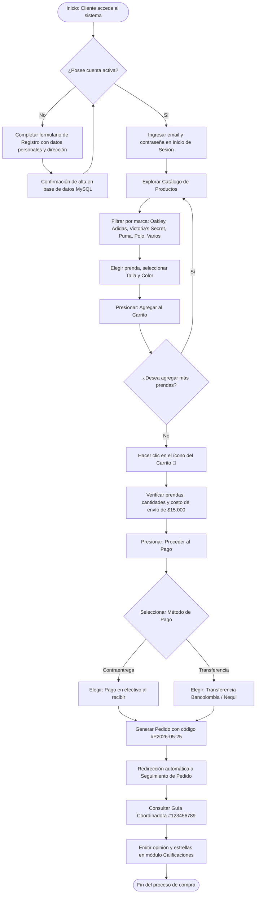
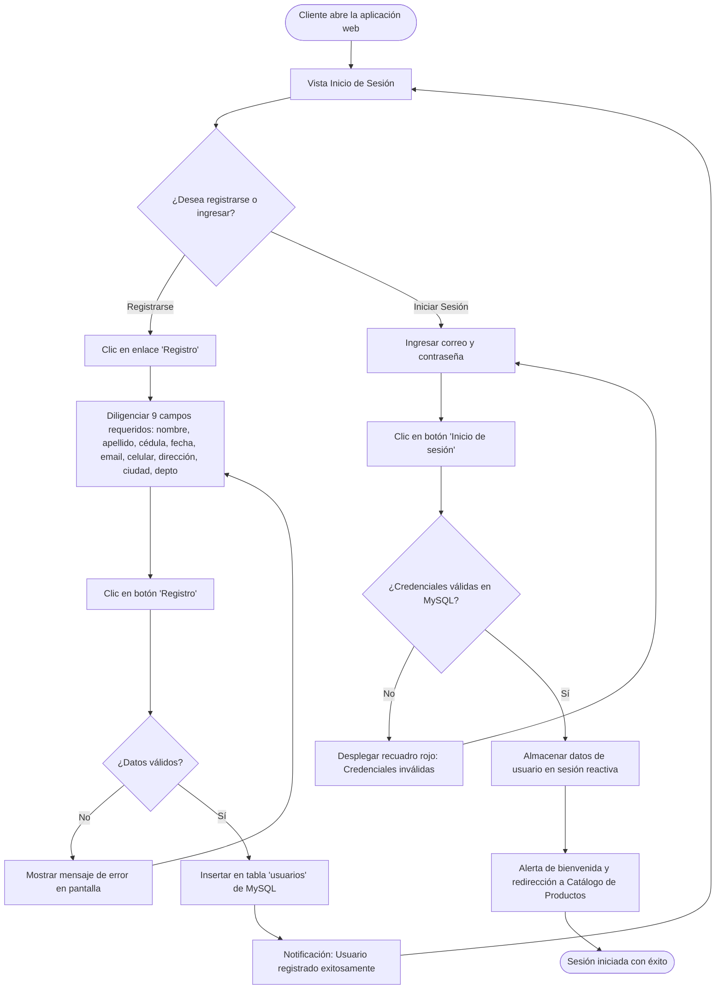
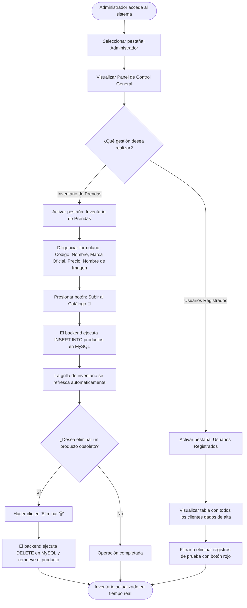

# SERVICIO NACIONAL DE APRENDIZAJE - SENA
## Centro de Formación en Tecnologías de la Información y las Comunicaciones
### Programa de Formación: Tecnología en Análisis y Desarrollo de Software (ADSO)

---

# EVIDENCIA DE APRENDIZAJE: GA10-220501097-AA11-EV01
## MANUAL DE USUARIO DEL SISTEMA DE INFORMACIÓN
### Plataforma Web de Comercio Electrónico y Gestión de Inventario *"Cachivaches NANA"*

**Documento elaborado conforme a la:**  
*Guía para la Elaboración de Manuales de Usuario de los Sistemas de Información* (Departamento Nacional de Planeación - DNP)  

* **Nombre del Sistema:** Plataforma Web Comercial Cachivaches NANA
* **Código del Sistema:** SI-NANA-2026
* **Versión del Manual:** 1.0 — Versión Oficial para Usuarios y Administradores
* **Fecha de Emisión:** Octubre de 2026
* **Autora / Aprendiz:** Lina María Rincón Prada (LMRP)
* **Ficha de Caracterización:** ADSO - 228118
* **Ubicación del Software:** `C:\Users\User\Documents\SENA TECNOLOGIA\proyecto`

---

## CONTROL DE VERSIONES Y HISTORIAL DE CAMBIOS

| Versión | Fecha | Autor(es) | Descripción del Cambio / Alcance | Aprobado Por |
|:---:|:---:|---|---|:---:|
| **0.1** | 15/09/2026 | Lina María Rincón | Estructuración inicial de pantallas y diagramación de flujos de usuario. | Comité Técnico ADSO |
| **0.2** | 28/09/2026 | Lina María Rincón | Incorporación de manuales para los módulos de Registro y Catálogo Multimarca. | Instructor Técnico |
| **1.0** | 14/10/2026 | Lina María Rincón | Versión final completa con pagos, seguimiento de guías, panel admin, capturas y FAQ. | Equipo Evaluador SENA |

---

## TABLA DE CONTENIDO

1. [Información General del Documento](#1-información-general-del-documento)
   - 1.1. Propósito del Manual
   - 1.2. Audiencia y Público Objetivo
   - 1.3. Convenciones Tipográficas y Visuales
2. [Introducción y Presentación del Sistema](#2-introducción-y-presentación-del-sistema)
   - 2.1. ¿Qué es Cachivaches NANA?
   - 2.2. Beneficios para el Usuario
3. [Requisitos de Acceso y Entorno del Usuario](#3-requisitos-de-acceso-y-entorno-del-usuario)
   - 3.1. Requisitos de Hardware del Cliente
   - 3.2. Navegadores Web Compatibles
   - 3.3. Dirección Web y Enlace de Conexión
4. [Estructura General de la Interfaz y Navegación](#4-estructura-general-de-la-interfaz-y-navegación)
   - 4.1. Barra de Navegación Superior (Navbar)
   - 4.2. Logotipo, Identidad y Lema Institucional
   - 4.3. Buscador Global y Contador del Carrito
   - 4.4. Pie de Página (Footer) y Datos de Contacto
5. [Instrucciones de Ingreso y Autenticación de Usuarios](#5-instrucciones-de-ingreso-y-autenticación-de-usuarios)
   - 5.1. Acceso a la Plataforma (Inicio de Sesión)
   - 5.2. Validación de Credenciales y Mensajes de Advertencia
   - 5.3. Registro de Nuevos Clientes
   - 5.4. Consulta y Eliminación en Lista de Usuarios (Control de Registro)
6. [Guía Funcional Paso a Paso de Módulos del Sistema](#6-guía-funcional-paso-a-paso-de-módulos-del-sistema)
   - 6.1. Módulo de Catálogo de Productos y Consulta Multimarca
   - 6.2. Módulo de Carrito de Compras
   - 6.3. Módulo de Checkout y Pasarela de Pagos
   - 6.4. Módulo de Seguimiento de Pedidos (Tracking con Transportadora)
   - 6.5. Módulo de Calificaciones y Opiniones (Sistema de Estrellas)
   - 6.6. Módulo "Acerca de Nosotros"
   - 6.7. Módulo del Panel de Administración (Gestión de Inventario y Clientes)
   - 6.8. Cierre de Sesión Seguro
7. [Diagramas de Flujos de Trabajo del Usuario](#7-diagramas-de-flujos-de-trabajo-del-usuario)
   - 7.1. Flujo Integral de Compra del Cliente
   - 7.2. Flujo de Autenticación y Registro
   - 7.3. Flujo de Gestión de Inventario por el Administrador
8. [Representaciones Visuales y Maquetas Esquemáticas de Interfaces](#8-representaciones-visuales-y-maquetas-esquemáticas-de-interfaces)
9. [Preguntas Frecuentes y Solución de Problemas (FAQ)](#9-preguntas-frecuentes-y-solución-de-problemas-faq)
10. [Glosario de Términos](#10-glosario-de-términos)
11. [Referencias Bibliográficas y Fuentes Normativas](#11-referencias-bibliográficas-y-fuentes-normativas)

---

## 1. INFORMACIÓN GENERAL DEL DOCUMENTO

### 1.1. Propósito del Manual
El presente **Manual de Usuario** tiene como finalidad orientar de forma clara, didáctica y secuencial a los usuarios finales (tanto clientes compradores como administradores de tienda) en la operación cotidiana de la plataforma web de comercio electrónico **Cachivaches NANA**. 

Siguiendo las directrices del **Departamento Nacional de Planeación (DNP)** en su *Guía para la elaboración de manuales de usuario de los sistemas de información*, este documento define los procedimientos operativos requeridos para acceder a los servicios, navegar por el catálogo multimarca, realizar pedidos seguros, gestionar envíos, emitir reseñas y administrar la base de datos de productos.

### 1.2. Audiencia y Público Objetivo
Este documento está dirigido a dos perfiles principales de usuario:
1. **Cliente / Comprador:** Usuario que interactúa con la interfaz comercial para explorar productos, consultar información de prendas por marcas, armar su carrito de compras, efectuar transacciones virtuales o contraentrega, rastrear sus despachos y publicar valoraciones.
2. **Administrador de Tienda:** Personal autorizado encargado del mantenimiento del inventario, adición de nuevas prendas a la base de datos MySQL, auditoría de clientes registrados y monitoreo general de operaciones.

### 1.3. Convenciones Tipográficas y Visuales
Para facilitar la lectura y comprensión del manual, se emplean los siguientes estilos y llamados de atención:

> [!NOTE]
> Información aclaratoria o contexto adicional relevante para el uso de una función.

> [!TIP]
> Sugerencias y recomendaciones de uso para agilizar la interacción con el sistema.

> [!IMPORTANT]
> Instrucciones o datos obligatorios que el usuario no debe omitir bajo ninguna circunstancia.

> [!WARNING]
> Advertencias sobre acciones que podrían borrar información o impedir la culminación de un pedido.

* **Negrita:** Botones, pestañas, opciones de menú y nombres exactos de campos en pantalla (ejemplo: **Agregar al Carrito**, **Registro**).
* `Código / Monospace:` Valores de ejemplo, rutas o URLs del aplicativo (ejemplo: `http://localhost:5173/`, `OAK-001`).

---

## 2. INTRODUCCIÓN Y PRESENTACIÓN DEL SISTEMA

### 2.1. ¿Qué es Cachivaches NANA?
**Cachivaches NANA** es una plataforma web desarrollada como solución tecnológica comercial para una tienda multimarca ubicada en el municipio de Bello (Antioquia), cuyo lema identificador es *"Lo que Sueñas a Precio Justo"*.

El software ofrece una experiencia de compra fluida mediante una arquitectura moderna tipo SPA (*Single Page Application*) construida en **Vue 3**, estilizada con **Tailwind CSS**, y respaldada por un servidor de servicios REST en **Node.js / Express** con almacenamiento relacional en **MySQL**.

### 2.2. Beneficios para el Usuario
* **Experiencia visual intuitiva:** Diseño minimalista en tonos pastel (verde olivo y púrpura real) adaptado para no fatigar la vista y facilitar la ubicación de productos.
* **Agilidad en la consulta multimarca:** Filtrado instantáneo sin recargas molestas de página para marcas líderes de moda como *Oakley, Adidas, Victoria's Secret, Puma, Polo y Variedades*.
* **Transparencia en costos:** Desglose claro entre valor de las prendas adquiridas, costo de flete logístico nacional (\$15.000 COP) y total final.
* **Trazabilidad en tiempo real:** Módulo de seguimiento en línea con integración de enlace directo al transportador logístico nacional (Coordinadora Mercantil).
* **Gestión simplificada:** Panel de administración unificado para cargar artículos al inventario con su respectivo código, categoría, precio y fotografía.

---

## 3. REQUISITOS DE ACCESO Y ENTORNO DEL USUARIO

Para interactuar con la plataforma web **Cachivaches NANA**, el usuario no requiere instalar software especializado en su ordenador ni contar con capacidades avanzadas de hardware.

### 3.1. Requisitos de Hardware del Cliente
* **Dispositivo:** Computador portátil, de escritorio, tableta o teléfono móvil con soporte para navegación web moderna.
* **Memoria RAM:** Mínimo 2 GB (recomendado 4 GB o superior para navegación simultánea fluida).
* **Resolución de Pantalla:** Mínima recomendada de 1280 x 720 píxeles para visualización en escritorio; compatible con diseño adaptable (*responsive design*).
* **Conexión a Red:** Acceso a red de datos local o Internet con velocidad de descarga de al menos 5 Mbps.

### 3.2. Navegadores Web Compatibles
La aplicación es compatible con cualquier navegador web moderno que admita el estándar **ECMAScript 6 (ES6)**:
* **Google Chrome:** Versión 110.0 o superior *(Recomendado)*.
* **Microsoft Edge:** Versión 110.0 o superior.
* **Mozilla Firefox:** Versión 115.0 o superior.
* **Safari:** Versión 16.0 o superior.

### 3.3. Dirección Web y Enlace de Conexión
Para ingresar al aplicativo en el entorno de desarrollo y pruebas formativas:
* **URL de Acceso Principal (Frontend):** `http://localhost:5173/`
* **URL del Servidor de Servicios (Backend API):** `http://localhost:8080/servidor_nana`

> [!IMPORTANT]
> Antes de abrir el navegador web, verifique que los servicios locales se encuentren activos ejecutando el archivo por lotes automatizado `INICIAR_PROYECTO.bat` ubicado en la carpeta principal del proyecto.

---

## 4. ESTRUCTURA GENERAL DE LA INTERFAZ Y NAVEGACIÓN

La interfaz de usuario de Cachivaches NANA ha sido organizada de manera limpia y uniforme a lo largo de todas las vistas, compuesta por cuatro áreas estructurales fijas:

```
+---------------------------------------------------------------------------------------+
|  BARRA DE NAVEGACIÓN (Navbar): [🏠 Inicio] [Productos ∨] [Acerca ∨] [Opiniones ∨]      |
|  [Admin]                  [ 🔍 Buscador de prendas... ]            [ 🛒 Carrito (N) ] |
+---------------------------------------------------------------------------------------+
|                                    ENCABEZADO                                         |
|                           [ LOGOTIPO DE LA TIENDA ]                                   |
|                        "Lo que Sueñas a Precio Justo"                                 |
+---------------------------------------------------------------------------------------+
|                                                                                       |
|                               ÁREA DE CONTENIDO DINÁMICO                              |
|          (Inicio de Sesión / Registro / Catálogo / Carrito / Pagos / Admin)           |
|                                                                                       |
+---------------------------------------------------------------------------------------+
|  PIE DE PÁGINA (Footer): © 2026 Cachivachez NANA | Bello - Antioquia | Tel: 300 010203|
+---------------------------------------------------------------------------------------+
```

### 4.1. Barra de Navegación Superior (Navbar)
Ubicada en la parte superior con un diseño traslúcido (*backdrop blur*), proporciona acceso inmediato a las principales secciones:
* **🏠 Inicio:** Permite regresar en cualquier momento a la pantalla inicial de autenticación o bienvenida.
* **Productos ∨:** Despliega el catálogo completo de prendas e indumentaria organizado por marcas oficiales.
* **Acerca de nosotros ∨:** Presenta la reseña histórica, misión, valores de calidad y cobertura de envíos de la tienda.
* **Opiniones ∨:** Conduce a la sección interactiva donde los compradores califican su experiencia y leen comentarios de otros clientes.
* **Administrador:** Acceso exclusivo al panel de control de inventario y base de datos de usuarios.

### 4.2. Logotipo, Identidad y Lema Institucional
En la parte superior central se despliega el distintivo corporativo oficial enmarcado en una tarjeta blanca con bordes redondeados y relieve sombreado, acompañado de la frase distintiva de la marca: *"Lo que Sueñas a Precio Justo"*.

### 4.3. Buscador Global y Contador del Carrito
* **Buscador:** Campo de texto interactivo con ícono de lupa (🔍) que permite filtrar en tiempo real las prendas por su nombre o referencia.
* **Ícono de Carrito (🛒):** Ubicado en el extremo superior derecho. Muestra una insignia flotante (*badge*) de color púrpura que indica la cantidad acumulada de productos seleccionados para compra. Al hacer clic sobre él, se transfiere al usuario a la vista de revisión de compra.

### 4.4. Pie de Página (Footer) y Datos de Contacto
Ubicado al final de la página, consolida los datos formales de la tienda:
* Derechos reservados: `© 2026 Cachivachez NANA. Todos los derechos reservados.`
* Correo de atención al cliente: `contacto@cachivacheznana.com`
* Línea telefónica / WhatsApp: `300 010203`
* Ubicación de la sede comercial: `Bello - Antioquia, Colombia`

---

## 5. INSTRUCCIONES DE INGRESO Y AUTENTICACIÓN DE USUARIOS

Para proteger la información personal y permitir la personalización de las compras, el sistema implementa un esquema de ingreso y registro sincronizado con la base de datos MySQL.

### 5.1. Acceso a la Plataforma (Inicio de Sesión)

```
+---------------------------------------------------------------------------------------+
|                                    INICIO DE SESIÓN                                   |
|                                                                                       |
|   Iniciar sesión con su email     Ingrese su contraseña                               |
|   [ email@email.com          ]    [ •••••••••••••••••• ]   [  INICIO DE SESIÓN  ]     |
|                                                            El usuario debe realizar   |
|                                                            el [ Registro ]            |
+---------------------------------------------------------------------------------------+
```

#### Pasos para iniciar sesión:
1. Abra su navegador web e ingrese a la dirección: `http://localhost:5173/`.
2. En la pantalla inicial, ubique los campos del formulario **Inicio de Sesión**.
3. En la casilla **"Iniciar sesión con su email"**, digite la dirección de correo con la cual se registró previamente (ejemplo: `lina.rincon@correo.com`).
4. En la casilla **"Ingrese su contraseña"**, digite su clave alfanumérica secreta.
5. Presione el botón púrpura **"Inicio de sesión"**.
6. Si las credenciales son válidas, el sistema mostrará un mensaje emergente de bienvenida: *"¡Bienvenido a Cachivachez NANA!"* y lo redireccionará de forma inmediata a la galería de **Productos**.

### 5.2. Validación de Credenciales y Mensajes de Advertencia
El sistema cuenta con validaciones preventivas:
* **Campos incompletos:** Si el usuario presiona el botón sin llenar alguno de los dos datos, la interfaz despliega un recuadro de alerta en color rojo:
  > *"Por favor, complete todos los campos."*
* **Credenciales incorrectas o inexistentes:** Si el correo o la contraseña no coinciden con los registros almacenados en la tabla `usuarios` de MySQL:
  > *"Credenciales inválidas. El usuario debe realizar el Registro."*
* **Falla de conexión con el servidor:** Si el backend `servidor_nana` no está activo en el puerto `8080`:
  > *"Error al conectar con el servidor backend."*

### 5.3. Registro de Nuevos Clientes
Si el usuario es nuevo o no posee una cuenta registrada en la base de datos, debe seleccionar el enlace subrayado **"Registro"** situado debajo del botón de ingreso.

```
+---------------------------------------------------------------------------------------+
|  REGISTRO DE NUEVO CLIENTE                                                            |
|                                                                                       |
|  [ Nombre ]                 [ Apellido ]             [ Email ]                        |
|  [ ____________________ ]   [ ____________________ ] [ ____________________ ]         |
|                                                                                       |
|  [ Número de Cédula ]       [ Fecha de Nacimiento ]  [ Celular ]                      |
|  [ ____________________ ]   [ dd / mm / aaaa       ] [ ____________________ ]         |
|                                                                                       |
|  [ Dirección ]              [ Ciudad ]               [ Departamento ]                 |
|  [ ____________________ ]   [ ____________________ ] [ ____________________ ]         |
|                                                                                       |
|                                  [  REGISTRO  ]                                       |
+---------------------------------------------------------------------------------------+
```

#### Formulario y Campos Obligatorios:

| Campo | Tipo / Formato | Regla de Validación | Ejemplo de Diligenciamiento |
|---|---|---|---|
| **Nombre** | Texto | Obligatorio, longitud máxima 100 caracteres | Lina María |
| **Apellido** | Texto | Obligatorio, longitud máxima 100 caracteres | Rincón Prada |
| **Número de Cédula** | Numérico / Texto | Sin puntos, guiones ni comas | 1020304050 |
| **Fecha de Nacimiento**| Calendario (Date) | Formato `AAAA-MM-DD` | 1995-05-12 |
| **Email** | Correo Electrónico | Formato estándar de correo (`usuario@dominio.com`) | lina.rincon@correo.com |
| **Celular** | Numérico / Teléfono | 10 dígitos para Colombia | 3001234567 |
| **Dirección** | Alfanumérico | Nomenclatura urbana completa | Calle 45 # 12-34, Apto 402 |
| **Ciudad** | Texto | Ciudad o municipio de residencia | Bello |
| **Departamento** | Texto | Departamento o provincia | Antioquia |

#### Proceso de Envío:
1. Diligencie la totalidad de los 9 campos solicitados.
2. Haga clic en el botón central **"Registro"**.
3. El sistema enviará la petición `POST` al endpoint `/servidor_nana/registro`.
4. Al completarse con éxito, se desplegará una notificación verde:
   > *"Usuario registrado exitosamente en la base de datos."*
5. El nuevo usuario quedará habilitado inmediatamente para iniciar sesión con su correo electrónico.

### 5.4. Consulta y Eliminación en Lista de Usuarios (Control de Registro)
En la parte inferior de la vista de registro se encuentra una tabla de consulta en tiempo real que lista los usuarios dados de alta en MySQL.
* **Consulta:** Muestra Nombre Completo, Cédula, Email, Celular y Ciudad de cada usuario.
* **Eliminación de registros de prueba:** Al pulsar el botón rojo **"Eliminar 🗑️"** de una fila, el sistema emite una confirmación de seguridad y envía una orden `DELETE` a la base de datos, removiendo al usuario y actualizando la grilla automáticamente.

---

## 6. GUÍA FUNCIONAL PASO A PASO DE MÓDULOS DEL SISTEMA

### 6.1. Módulo de Catálogo de Productos y Consulta Multimarca

Este módulo permite a los clientes explorar el inventario de prendas y accesorios disponibles en la tienda.

```
+---------------------------------------------------------------------------------------+
|  PRODUCTOS                                           [ Buscar prenda...  🔍 ]         |
|  Filtros: [🔥 Todas] [🕶️ Oakley] [👟 Adidas] [🌸 Victoria Secret] [🐆 Puma] [🐎 Polo]  |
|                                                                                       |
|  +------------------------+  +------------------------+  +------------------------+   |
|  |       [ FOTO ]         |  |       [ FOTO ]         |  |       [ FOTO ]         |   |
|  | OAKLEY                 |  | ADIDAS                 |  | VICTORIA SECRET         |   |
|  | Buso Deportivo         |  | Tenis Running          |  | Pijama Seda            |   |
|  | Código: OAK-001        |  | Código: ADI-001        |  | Código: VS-001         |   |
|  | [Talla ∨] [Color ∨]    |  | [Talla ∨] [Color ∨]    |  | [Talla ∨] [Color ∨]    |   |
|  | $ 190.000              |  | $ 240.000              |  | $ 180.000              |   |
|  | [ AGREGAR AL CARRITO ] |  | [ AGREGAR AL CARRITO ] |  | [ AGREGAR AL CARRITO ] |   |
|  +------------------------+  +------------------------+  +------------------------+   |
+---------------------------------------------------------------------------------------+
```

#### Funcionalidades del Catálogo:
1. **Filtrado por Marcas Oficiales:**
   En la cabecera del catálogo o desde el menú de la barra superior, el usuario puede seleccionar una de las categorías comerciales:
   * **Todas:** Muestra el catálogo integral de 25 referencias.
   * **Oakley:** Muestra busos, camisetas, pantalones, gorras y gafas de sol deportivas.
   * **Adidas:** Muestra calzado tenis, chaquetas térmicas, camisetas y sudaderas urbanas.
   * **Victoria's Secret:** Muestra pijamas, batas de seda, lociones, bolsos y colonias splash.
   * **Puma:** Muestra sudaderas hoodie, joggers, morrales y calzado deportivo.
   * **Polo:** Muestra camisas tipo polo clásicas, gorras y billeteras de cuero.
   * **Varios:** Muestra accesorios de moda como relojes, riñoneras, cinturones y termos térmicos.
2. **Selector de Tallas y Colores:**
   Cada tarjeta de producto cuenta con selectores desplegables independientes:
   * **Talla:** S, M, L, XL.
   * **Color:** Negro, Blanco, Gris.
3. **Formato de Precios:**
   Los precios se presentan en pesos colombianos con separador de miles oficial (ejemplo: `$ 190.000 COP`).
4. **Adición al Carrito:**
   Al hacer clic en el botón púrpura **"Agregar al Carrito"**, el sistema:
   * Verifica si la prenda ya existe en el pedido del cliente; de ser así, incrementa su cantidad.
   * Si es la primera vez que se añade, ingresa la prenda con cantidad inicial `1`.
   * Despliega una alerta interactiva confirmando la adición: *"¡[Nombre del producto] agregado al carrito!"*.
   * Actualiza inmediatamente el número mostrado en la burbuja del carrito (🛒).

---

### 6.2. Módulo de Carrito de Compras

Permite a los usuarios inspeccionar los productos seleccionados, verificar precios unitarios, modificar cantidades o descartar artículos antes de proceder al pago.

```
+---------------------------------------------------------------------------------------+
|  CARRITO DE COMPRAS                                                                   |
|                                                                                       |
|  +---------------------------------------------------+  +---------------------------+ |
|  | [FOTO] Buso Deportivo - Oakley                    |  | 📍 DIRECCIÓN DE ENVÍO     | |
|  |        $ 190.000   [ - ] 1 [ + ]   [ 🗑️ Eliminar ] |  | Lina María Rincón         | |
|  +---------------------------------------------------+  | Calle 45 # 12-34          | |
|  | [FOTO] Tenis Running - Adidas                     |  | Bello - Antioquia         | |
|  |        $ 240.000   [ - ] 2 [ + ]   [ 🗑️ Eliminar ] |  +---------------------------+ |
|  +---------------------------------------------------+  | RESUMEN DE TOTALES        | |
|                                                         | Subtotal:      $ 670.000  | |
|                                                         | Envío nacional: $ 15.000  | |
|                                                         | TOTAL NETO:    $ 685.000  | |
|                                                         | [  PROCEDER AL PAGO  ]    | |
|                                                         +---------------------------+ |
+---------------------------------------------------------------------------------------+
```

#### Operaciones en el Carrito:
1. **Modificación de Cantidades:**
   * Presione el botón **`[ + ]`** para sumar una unidad adicional de la prenda.
   * Presione el botón **`[ - ]`** para reducir la cantidad (si llega a 1, no descenderá a menos que se presione eliminar).
2. **Remoción de Artículos:**
   * Haga clic sobre el ícono del bote de basura **`🗑️`** para remover por completo la prenda seleccionada.
3. **Validación de la Dirección de Entrega:**
   * En la columna derecha, el usuario puede revisar los datos del destinatario tomados automáticamente de su sesión activa.
4. **Cálculo Financiero Automatizado:**
   * **Subtotal:** Sumatoria exacta de `(precio_unitario * cantidad)` de todos los artículos.
   * **Costo de Envío:** Tarifa fija logística nacional de **\$15.000 COP**.
   * **Total a Pagar:** Sumatoria del subtotal más el flete de despacho.
5. **Avanzar al Checkout:**
   * Al presionar **"Proceder al Pago"**, el aplicativo transfiere al comprador a la pantalla de liquidación y pagos.

---

### 6.3. Módulo de Checkout y Pasarela de Pagos

En esta sección el cliente revisa el resumen consolidado de la orden de compra y selecciona su modalidad de pago preferida.

```
+---------------------------------------------------------------------------------------+
|  PAGOS                                                                                |
|                                                                                       |
|  +---------------------------------------------------------------------------------+  |
|  | 📦 RESUMEN DE LA ORDEN                                                          |  |
|  | Número de Pedido: # P2026-05-25   |  Valor Productos: $ 670.000                 |  |
|  | Costo de Envío: $ 15.000          |  TOTAL NETO A PAGAR: $ 685.000              |  |
|  +---------------------------------------------------------------------------------+  |
|                                                                                       |
|  SELECCIONE SU MÉTODO DE PAGO:                                                        |
|  +-----------------------------------+   +-----------------------------------------+  |
|  | [ 💵 ] PAGO CONTRA ENTREGA        |   | [ 💳 ] TRANSFERENCIA BANCARIA           |  |
|  | Paga en efectivo al recibir en   |   | Bancolombia / Nequi / Daviplata         |  |
|  | tu domicilio.                     |   | Envía comprobante al WhatsApp 300010203 |  |
|  +-----------------------------------+   +-----------------------------------------+  |
|                                                                                       |
|                           [  CONFIRMAR Y FINALIZAR PEDIDO  ]                          |
+---------------------------------------------------------------------------------------+
```

#### Métodos de Pago Disponibles:
1. **Pago contra entrega (Efectivo):**
   * Modalidad ideal para compras locales y despachos con cobro al momento de la entrega física del paquete.
2. **Transferencia Electrónica (Bancolombia / Nequi):**
   * Despliega los números de cuenta oficial de la tienda y código QR para transferencias inmediatas sin costo adicional.
3. **Confirmación del Pedido:**
   * Al pulsar el botón **"Confirmar y Finalizar Pedido"**, el sistema genera el código de orden, emite una confirmación en pantalla, vacía el carrito de compras en `localStorage` y redirige automáticamente al módulo de **Seguimiento de Pedido**.

---

### 6.4. Módulo de Seguimiento de Pedidos (Tracking con Transportadora)

Ofrece visibilidad total al comprador sobre el ciclo logístico y estado físico de su despacho.

```
+---------------------------------------------------------------------------------------+
|  SEGUIMIENTO DE PEDIDO                                   Usuario: Lina María Rincón   |
|  Pedido # P2025-11-01                                                                 |
|                                                                                       |
|  LÍNEA DE TIEMPO DEL ENVÍO:                                                           |
|                                                                                       |
|  [ 🟢 ] Pedido Pagado .................................... Fecha: 2025-11-15          |
|                                                                                       |
|  [ 🚚 ] Pedido Despachado ................................ Fecha: 2025-11-16          |
|                                                                                       |
|  [ 📦 ] Recogido por Transportadora ...................... Fecha: 2025-11-17          |
|         Empresa: Coordinadora - Guía #123456789                                       |
|         [  SEGUIR TRANSPORTADORA  ] -> Enlaza a coordinadora.com                      |
|                                                                                       |
|  [ ⚪ ] Pedido Entregado ................................. Pendiente de confirmación   |
|                                                                                       |
|  DIRECCIÓN DE ENTREGA REGISTRADA: Calle 45 # 12-34, Bello - Antioquia                 |
+---------------------------------------------------------------------------------------+
```

#### Características del Seguimiento:
* **Identificación del Usuario:** Encabezado con el nombre del cliente autenticado.
* **Estados Logísticos Secuenciales:**
  1. `Pedido Pagado:` Confirma la validación contable de la transacción.
  2. `Pedido Despachado:` Paquete embalado y rotulado en bodega.
  3. `Recogido por Transportadora:` En manos de la empresa de envíos nacional (*Coordinadora Mercantil*), indicando el número de guía asignado (`Guía #123456789`).
  4. `Pedido Entregado:` Marca de culminación del servicio logístico al llegar a la puerta del cliente.
* **Botón Interactivo "Seguir Transportadora":** Abre en una pestaña nueva el portal oficial de rastreo de paquetes de la transportadora para consultar los puntos de control en ruta.

---

### 6.5. Módulo de Calificaciones y Opiniones (Sistema de Estrellas)

Espacio comunitario de retroalimentación donde los clientes evalúan la calidad de las prendas, el tiempo de despacho y la atención recibida.

```
+---------------------------------------------------------------------------------------+
|  CALIFICACIONES Y OPINIONES                                                           |
|                                                                                       |
|  DANOS TU OPINIÓN                        OPINIONES DE NUESTROS CLIENTES               |
|  +------------------------------------+  +------------------------------------------+ |
|  | Tu Nombre:                         |  | ⭐⭐⭐⭐⭐  Lina María Rincón              | |
|  | [ Lina María Rincón              ] |  | "Excelente calidad en las prendas Oakley.| |
|  |                                    |  | El buso me quedó a la medida y llegó en  | |
|  | Calificación:                      |  | 2 días a Bello."                         | |
|  | [ ⭐ ] [ ⭐ ] [ ⭐ ] [ ⭐ ] [ ☆ ]  |  +------------------------------------------+ |
|  | (Haz clic para calificar)          |  | ⭐⭐⭐⭐⭐  Carlos Gómez                  | |
|  |                                    |  | "Los tenis Adidas son 100% auténticos.   | |
|  | Tu Comentario:                     |  | Muy recomendado este almacén."           | |
|  | [ ¿Qué tal te pareció tu        ]  |  +------------------------------------------+ |
|  | [ experiencia en Cachivaches?   ]  |                                             | |
|  |                                    |                                             | |
|  | [  ENVIAR RESEÑA 🚀  ]              |                                             | |
|  +------------------------------------+                                             | |
+---------------------------------------------------------------------------------------+
```

#### Pasos para Calificar la Tienda:
1. Diríjase a la opción **"Opiniones ∨"** de la barra de navegación superior.
2. En la casilla **"Tu Nombre"**, escriba su nombre y apellido.
3. En la sección **"Calificación"**, haga clic sobre las estrellas doradas para seleccionar su puntuación (desde 1 estrella para insatisfecho hasta 5 estrellas para excelente servicio).
4. En el recuadro de texto **"Tu Comentario"**, redacte su opinión libre sobre los productos o el proceso de entrega.
5. Presione el botón **"Enviar Reseña 🚀"**.
6. El comentario se publicará al instante en la cartelera comunitaria lateral con la fecha y hora de emisión.

---

### 6.6. Módulo "Acerca de Nosotros"

Presenta la información corporativa, filosofía y compromisos comerciales de la empresa.
* **¿Quiénes Somos?:** Reseña sobre el origen de la tienda en Bello, Antioquia, y su visión de moda urbana accesible.
* **Pilares de Confianza:**
  * *Garantía de Calidad:* Ropa y calzado seleccionados bajo altos estándares de confección.
  * *Despacho Nacional:* Cobertura de envíos a todos los municipios de Colombia mediante transportadoras aliadas.
  * *Atención Personalizada:* Canales directos de soporte vía chat y teléfono.
* **Botón de Acción Rápida:** Incluye el botón **"Explorar Catálogo 🛍️"** para volver de inmediato a la selección de prendas.

---

### 6.7. Módulo del Panel de Administración (Gestión de Inventario y Clientes)

Accesible para los administradores del establecimiento comercial para gestionar la información centralizada en MySQL.

```
+---------------------------------------------------------------------------------------+
|  PANEL DE CONTROL GENERAL (ADMINISTRADOR)                                             |
|  [ 🛍️ Inventario de Prendas ]              [ 👥 Usuarios Registrados ]                 |
|                                                                                       |
|  REGISTRAR NUEVA PRENDA                    INVENTARIO EN BASE DE DATOS (25 prendas)   |
|  +--------------------------------------+  +----------------------------------------+ |
|  | Código Único:   [ OAK-006          ] |  | CÓDIGO  | PRENDA     | MARCA  | PRECIO   | |
|  | Nombre Prenda:  [ Chaqueta Térmica ] |  | OAK-001 | Buso       | Oakley | $190.000 | |
|  | Marca Oficial:  [ Oakley ∨         ] |  | ADI-001 | Tenis      | Adidas | $240.000 | |
|  | Precio (COP $): [ 210000           ] |  | VS-001  | Pijama     | V.S.   | $180.000 | |
|  | Archivo Imagen: [ chaqueta.jpg     ] |  | [ Acciones: 🗑️ Eliminar de MySQL ]     | |
|  | [  🚀 SUBIR AL CATÁLOGO  ]           |  +----------------------------------------+ |
|  +--------------------------------------+                                             |
+---------------------------------------------------------------------------------------+
```

#### Funcionalidades Administrativas:
1. **Pestaña "Inventario de Prendas":**
   * **Alta de Nuevas Prendas:** Permite introducir código comercial, nombre de prenda, marca oficial en menú desplegable (*Oakley, Adidas, Victoria Secret, Puma, Polo, Varios*), precio numérico y nombre del archivo de imagen. Al pulsar **"Subir al Catálogo"**, el registro se inserta en la base de datos MySQL y queda disponible para compra en el frontend.
   * **Filtro de Inventario:** Permite filtrar la tabla administrativa por marcas para auditar existencias.
   * **Baja de Prendas:** Cada fila incluye un botón **"Eliminar 🗑️"** que suprime el producto obsoleto del catálogo.
2. **Pestaña "Usuarios Registrados":**
   * Despliega la nómina de todos los compradores dados de alta en el sistema con sus datos de contacto y dirección.
   * Permite actualizar la lista con el botón **"Actualizar Lista 🔄"** o dar de baja usuarios inactivos.

---

### 6.8. Cierre de Sesión Seguro
Para proteger la privacidad de los clientes en equipos compartidos:
1. El usuario hace clic en la opción de salida o regresa a la pantalla de inicio.
2. El sistema emite un cuadro de diálogo de confirmación:
   > *"¿Deseas cerrar tu sesión actual?"*
3. Al aceptar, el aplicativo ejecuta una limpieza integral:
   * Limpia los valores en memoria del nombre y correo del usuario activo.
   * Elimina las llaves de sesión en el almacenamiento del navegador (`localStorage.removeItem`).
   * Limpia los campos de texto del formulario de ingreso para que un tercero no pueda visualizar la contraseña o correo previamente introducido.
   * Restablece la vista al estado inicial seguro.

---

## 7. DIAGRAMAS DE FLUJOS DE TRABAJO DEL USUARIO

### 7.1. Flujo Integral de Compra del Cliente



---

### 7.2. Flujo de Autenticación y Registro



---

### 7.3. Flujo de Gestión de Inventario por el Administrador



---

## 8. REPRESENTACIONES VISUALES Y MAQUETAS ESQUEMÁTICAS DE INTERFACES

A continuación se presentan las maquetas funcionales representativas correspondientes a las pantallas y componentes desarrollados en la aplicación:

### 8.1. Pantalla 1: Inicio de Sesión y Bienvenida
```
==========================================================================================
 CACHIVACHES NANA                              [ 🔍 Buscador ]           [ 🛒 Carrito (0) ]
 [ 🏠 Inicio ]   [ Productos ∨ ]   [ Acerca de nosotros ∨ ]   [ Opiniones ∨ ]   [ Admin ]
==========================================================================================

                             +-----------------------------+
                             |   [ FOTO LOGO DE TIENDA ]   |
                             +-----------------------------+
                              "Lo que Sueñas a Precio Justo"

  INICIO DE SESIÓN
  ----------------------------------------------------------------------------------------
  Iniciar sesión con su email:     Ingrese su contraseña:
  [ lina.rincon@correo.com       ] [ ••••••••••••••••         ]   [ INICIO DE SESIÓN ]

                                                                  El usuario debe realizar 
                                                                  el [ Registro ]
==========================================================================================
 © 2026 Cachivachez NANA | contacto@cachivacheznana.com | Tel: 300 010203 | Bello - Antioquia
==========================================================================================
```

### 8.2. Pantalla 2: Catálogo de Productos con Filtros Multimarca
```
==========================================================================================
 PRODUCTOS                                                     [ Buscar prenda...  🔍 ]
 Filtros: [🔥 Todas (25)] [🕶️ Oakley] [👟 Adidas] [🌸 Victoria Secret] [🐆 Puma] [🐎 Polo]
==========================================================================================

 +--------------------------+  +--------------------------+  +--------------------------+
 |       [ IMAGEN ]         |  |       [ IMAGEN ]         |  |       [ IMAGEN ]         |
 | OAKLEY                   |  | ADIDAS                   |  | PUMA                     |
 | Buso Deportivo Con Capota|  | Chaqueta Térmica Stripes |  | Hoodie Urbano Black      |
 | Código: OAK-001          |  | Código: ADI-002          |  | Código: PUM-001          |
 | Talla: [ M ∨ ]           |  | Talla: [ L ∨ ]           |  | Talla: [ S ∨ ]           |
 | Color: [ Negro ∨ ]       |  | Color: [ Azul ∨ ]        |  | Color: [ Gris ∨ ]        |
 | $ 190.000 COP            |  | $ 210.000 COP            |  | $ 185.000 COP            |
 | [ + AGREGAR AL CARRITO ] |  | [ + AGREGAR AL CARRITO ] |  | [ + AGREGAR AL CARRITO ] |
 +--------------------------+  +--------------------------+  +--------------------------+
```

### 8.3. Pantalla 3: Carrito de Compras y Desglose Financiero
```
==========================================================================================
 CARRITO DE COMPRAS                                            Total Artículos: 2 prendas
==========================================================================================

 ARTÍCULOS EN EL CARRITO (2)                             DIRECCIÓN DE ENTREGA
 +-----------------------------------------------------+ +------------------------------+
 | [IMG] Buso Deportivo Con Capota - Oakley            | | Lina María Rincón            |
 |       $ 190.000 COP    Cant: [ - ] 1 [ + ]   [ 🗑️ ] | | Calle 45 # 12-34, Apt 402    |
 +-----------------------------------------------------+ | Bello - Antioquia            |
 | [IMG] Chaqueta Térmica Stripes - Adidas             | +------------------------------+
 |       $ 210.000 COP    Cant: [ - ] 1 [ + ]   [ 🗑️ ] | RESUMEN DE TOTALES
 +-----------------------------------------------------+ | Subtotal:          $ 400.000 |
                                                         | Flete Nacional:     $ 15.000 |
                                                         | TOTAL A PAGAR:     $ 415.000 |
                                                         | [  PROCEDER AL PAGO  ]       |
                                                         +------------------------------+
```

### 8.4. Pantalla 4: Liquidación de Pagos (Checkout)
```
==========================================================================================
 PAGOS                                                          Pedido # P2026-05-25
==========================================================================================

 RESUMEN DEL PEDIDO
 +--------------------------------------------------------------------------------------+
 | Número de Orden: # P2026-05-25  |  Subtotal: $ 400.000 COP  |  Envío: $ 15.000 COP   |
 | TOTAL NETO A PAGAR: $ 415.000 COP                                                    |
 +--------------------------------------------------------------------------------------+

 SELECCIONE SU MÉTODO DE PAGO:
 +---------------------------------------+  +-------------------------------------------+
 | [ 💵 ] PAGO CONTRA ENTREGA (EFECTIVO) |  | [ 💳 ] TRANSFERENCIA ELECTRÓNICA          |
 | Cancela al mensajero en la puerta     |  | Bancolombia / Nequi / Daviplata           |
 | de tu residencia al recibir el pedido |  | Cuenta Corriente No. 123-456789-00        |
 +---------------------------------------+  +-------------------------------------------+

                           [  CONFIRMAR Y FINALIZAR PEDIDO  ]
```

### 8.5. Pantalla 5: Seguimiento y Rastreo de Pedido
```
==========================================================================================
 SEGUIMIENTO DE PEDIDO                                          Cliente: Lina María Rincón
==========================================================================================

 ORDEN ACTIVA: # P2025-11-01
 +--------------------------------------------------------------------------------------+
 | (●) ESTADO 1: Pedido Pagado ............................ Fecha: 2025-11-15 (Completado)
 |
 | (●) ESTADO 2: Pedido Despachado ........................ Fecha: 2025-11-16 (Completado)
 |
 | (●) ESTADO 3: Recogido por Transportadora .............. Fecha: 2025-11-17 (En Camino)
 |     Empresa: Coordinadora Mercantil
 |     Número de Guía: # 123456789
 |     >>> [ SEGUIR TRANSPORTADORA (coordinadora.com) ] <<<
 |
 | (○) ESTADO 4: Pedido Entregado ......................... En tránsito a Bello, Ant.
 +--------------------------------------------------------------------------------------+
 Destino: Calle 45 # 12-34, Bello - Antioquia | Teléfono de Contacto: 300 1234567
```

---

## 9. PREGUNTAS FRECUENTES Y SOLUCIÓN DE PROBLEMAS (FAQ)

### P1: ¿Qué debo hacer si al presionar "Inicio de sesión" aparece un error de conexión?
* **Causa:** El servidor de servicios en Node.js (`server.js`) no se está ejecutando o el motor MySQL está detenido en el panel de XAMPP.
* **Solución:**
  1. Abra el panel de control de **XAMPP** y verifique que el servicio **MySQL** tenga el indicador en verde.
  2. Ejecute el archivo [`INICIAR_PROYECTO.bat`](file:///C:/Users/User/OneDrive/Documentos/SENA%20TECNOLOGIA/proyecto/INICIAR_PROYECTO.bat) ubicado en la raíz del proyecto para reiniciar automáticamente el backend en el puerto `8080`.

### P2: ¿Por qué no se borran los datos del formulario al cerrar la sesión?
* **Causa:** El almacenamiento temporal del navegador conservaba variables cacheadas.
* **Solución:** En la versión actual del sistema, al pulsar cerrar sesión o confirmar la salida, se ejecuta automáticamente el limpiador reactivo que vacía los inputs del formulario y elimina las entradas `usuarioEmail` y `cachivaches_carrito` de `localStorage`.

### P3: ¿Cómo sé si mi pedido fue registrado exitosamente?
* **Respuesta:** Al presionar **"Confirmar y Finalizar Pedido"**, la aplicación emite una ventana de confirmación indicando el método de pago seleccionado, limpia el carrito de compras e inmediatamente le muestra la línea de tiempo de **Seguimiento de Pedido** con su código de orden.

### P4: ¿Por qué no aparecen fotos de algunas prendas en el catálogo?
* **Causa:** El nombre del archivo en la base de datos no coincide con los archivos gráficos alojados en la carpeta `src/assets/`.
* **Solución:** Ingrese al módulo de **Administrador**, verifique que el campo `imagen_url` coincida exactamente con el nombre de archivo existente (por ejemplo `buso.jpg`, `camiseta_adidas.jpg`, `locion_vs.jpg`). Si se omite, el sistema asignará una imagen predeterminada de catálogo.

### P5: ¿Puedo comprar productos de diferentes marcas en un mismo pedido?
* **Respuesta:** Sí. El carrito de compras es global y permite acumular prendas de diferentes marcas (*Oakley, Adidas, Victoria Secret, Puma, Polo, Varios*) dentro de una sola orden con un único costo de envío nacional consolidado.

---

## 10. GLOSARIO DE TÉRMINOS

* **ACID (Atomicidad, Consistencia, Aislamiento, Durabilidad):** Conjunto de propiedades que garantizan que las transacciones de bases de datos se procesen de manera confiable en el motor InnoDB de MySQL.
* **API REST (Representational State Transfer):** Interfaz de comunicación entre el frontend (Vue 3) y el backend (Node.js) basada en peticiones HTTP seguras y respuestas en formato JSON.
* **Carrito de Compras:** Componente de software reactivo donde el usuario acumula temporalmente las prendas y accesorios seleccionados antes de realizar el pago.
* **Checkout:** Etapa final del comercio electrónico donde el comprador revisa el desglose del pedido, confirma la dirección y escoge la pasarela de pago.
* **DNP (Departamento Nacional de Planeación):** Entidad gubernamental colombiana que emite estándares y guías técnicas para la elaboración de manuales y documentación de sistemas de información.
* **Flete de Envío:** Tarifa de transporte logístico aplicada para el traslado de las mercancías desde la sede en Bello (Antioquia) hasta el domicilio del cliente en el territorio colombiano.
* **LocalStorage:** Mecanismo de persistencia del navegador web que permite retener temporalmente los artículos del carrito o datos de sesión activa sin riesgo de fuga.
* **Moneda COP:** Unidad monetaria oficial (Peso Colombiano) utilizada en toda la tasación de precios del catálogo de Cachivaches NANA.
* **Single Page Application (SPA):** Aplicación web que carga una sola página HTML y actualiza dinámicamente el contenido a medida que el usuario interactúa con ella, ofreciendo transiciones instantáneas sin recargas completas.
* **Tracking / Rastreo:** Funcionalidad que permite al cliente conocer la ubicación y estado operativo de su paquete a través del código de guía de la transportadora logística.

---

## 11. REFERENCIAS BIBLIOGRÁFICAS Y FUENTES NORMATIVAS

1. **Departamento Nacional de Planeación - DNP. (2018).** *Guía para la elaboración de manuales de usuario de los sistemas de información*. Dirección de Tecnologías de Información y Comunicaciones (DTIC). Bogotá D.C., Colombia.
2. **Servicio Nacional de Aprendizaje - SENA. (2024).** *Componente Formativo: Actividades de documentación y entrega de software en procesos de implantación (CF33)*. Programa Tecnología en Análisis y Desarrollo de Software (ADSO).
3. **Servicio Nacional de Aprendizaje - SENA. (2024).** *Guía de Aprendizaje N° 10: Implantación y Entrega de Soluciones de Software*. Centro de Formación TIC.
4. **Organización Internacional de Normalización - ISO/IEC. (2011).** *ISO/IEC 25010: Systems and software engineering — Systems and software Quality Requirements and Evaluation (SQuaRE) — System and software quality models*. Ginebra, Suiza.
5. **Vue.js Core Team. (2024).** *Vue 3 Documentation: The Progressive JavaScript Framework*. Disponible en: [https://vuejs.org](https://vuejs.org)
6. **Tailwind Labs Inc. (2024).** *Tailwind CSS Documentation: Utility-First CSS Framework*. Disponible en: [https://tailwindcss.com](https://tailwindcss.com)
7. **Coordinadora Mercantil S.A. (2024).** *Portal de Rastreo y Seguimiento de Guías Nacionales*. Disponible en: [https://coordinadora.com](https://coordinadora.com)
