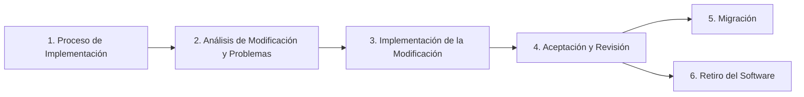

# SERVICIO NACIONAL DE APRENDIZAJE - SENA
## Centro de Formación en Tecnologías de la Información y las Comunicaciones
### Programa: Tecnología en Análisis y Desarrollo de Software (ADSO)

---

# EVIDENCIA DE APRENDIZAJE: GA10-220501097-AA8-EV01
## DISEÑO DEL PLAN DE MANTENIMIENTO Y SOPORTE DEL SOFTWARE

**Proyecto Formativo:** Sistema Web de Gestión y Comercialización de Prendas Multimarca *"Cachivaches NANA"*  
**Norma Técnica de Referencia:** Estándar Internacional ISO/IEC 14764 (ISO 14724) — *Software Engineering — Software Life Cycle Processes — Maintenance*  
**Ubicación del Software:** `C:\Users\User\Documents\SENA TECNOLOGIA\proyecto`  
**Ambiente de Producción / Base de Datos:** `localhost / 127.0.0.1 / cachivachez_nana_db | phpMyAdmin 5.2.1`  
**Fecha de Emisión:** Octubre de 2026  
**Versión del Plan:** 1.0 — Oficial

---

## 1. INTRODUCCIÓN Y OBJETIVOS

### 1.1. Introducción
El ciclo de vida de un sistema de software no concluye con su puesta en producción; por el contrario, inicia una etapa crítica donde el aplicativo debe preservarse operativo, seguro, adaptado a los cambios del negocio y libre de defectos. El presente documento formaliza el **Plan de Mantenimiento y Soporte de Software** para la plataforma web **Cachivaches NANA**, aplicando los lineamientos y etapas metodológicas del estándar internacional **ISO/IEC 14764** (reconocido en el marco formativo como ISO 14724).

### 1.2. Objetivo General
Diseñar, estructurar y calendarizar el plan de mantenimiento preventivo y correctivo de la aplicación web Cachivaches NANA, garantizando una alta disponibilidad del servicio, salvaguarda de la integridad de la base de datos MySQL, mitigación de vulnerabilidades y resolución ágil de incidencias técnicas.

### 1.3. Objetivos Específicos
* Definir los procedimientos operativos para el tratamiento de fallos imprevistos (**Mantenimiento Correctivo**).
* Programar rutinas periódicas de optimización, copias de seguridad, depuración de logs y actualización de dependencias (**Mantenimiento Preventivo**).
* Establecer los Acuerdos de Nivel de Servicio (SLA) para clasificación, priorización y tiempos de respuesta de solicitudes de modificación.
* Formular las directrices de migración técnica hacia infraestructuras escalables y el protocolo de retiro seguro del software conforme a la legislación de protección de datos (*Habeas Data*).

---

## 2. MARCO NORMATIVO: ESTÁNDAR ISO/IEC 14764 (ISO 14724)

El estándar **ISO/IEC 14764** rige los procesos del ciclo de vida del mantenimiento del software, categorizando los tipos de intervención y estructurando 6 procesos iterativos fundamentales:



### Clasificación de Tipos de Mantenimiento según la Norma:
1. **Mantenimiento Correctivo:** Acción reactiva ejecutada tras la detección de un fallo, defecto o anomalía con el propósito de restablecer la funcionalidad normal del sistema (ej. caída de conexión MySQL, error de validación en pasarela de pagos).
2. **Mantenimiento Preventivo:** Acción proactiva destinada a detectar y corregir problemas latentes antes de que se manifiesten como fallas operativas (ej. mantenimiento de índices de base de datos, actualización de parches de seguridad de paquetes npm, revisión preventiva de fugas de memoria).
3. **Mantenimiento Adaptativo:** Modificaciones para mantener el software operativo ante cambios en el entorno tecnológico o de infraestructura (ej. actualización de versión mayor de Node.js o motor MariaDB).
4. **Mantenimiento Perfectivo:** Mejoras no orientadas a fallos sino al incremento del rendimiento, refactorización de código o usabilidad general.

---

## 3. DESCRIPCIÓN DEL SISTEMA

### 3.1. Identificación de la Solución
**Cachivaches NANA** es una plataforma web de comercio electrónico y administración de inventario orientada a la comercialización de prendas de vestir y accesorios de marcas internacionales (*Oakley, Adidas, Victoria's Secret, Puma, Polo, Varios*).

### 3.2. Arquitectura Tecnológica

```
+-------------------------------------------------------------------------+
|                  ARQUITECTURA WEB - CACHIVACHES NANA                    |
+------------------------------------+------------------------------------+
| 1. CAPA DE PRESENTACIÓN (FRONTEND) | 2. CAPA DE NEGOCIO (BACKEND)       |
|    • Framework: Vue 3 (Composition)|    • Runtime: Node.js (v24.x)      |
|    • Empaquetador: Vite 8          |    • Framework: Express.js (v5.x)  |
|    • Estilos: Tailwind CSS         |    • Protocolo: REST API JSON      |
|    • Almacenamiento: localStorage  |    • Conexión: mysql2 ConnectionPool|
+------------------------------------+------------------------------------+
| 3. CAPA DE DATOS (DATABASE)        | 4. AMBIENTE DE DESPLIEGUE          |
|    • Gestor: MySQL 8.x / MariaDB   |    • Entorno Local: Windows 11     |
|    • Administración: phpMyAdmin    |    • Servidor Web Backend: :8080   |
|    • Base de datos: cachivachez_...|    • Servidor Web Frontend: :5173  |
|    • Tablas: usuarios, productos,  |    • Scripts de arranque: .bat     |
|      calificaciones                |                                    |
+------------------------------------+------------------------------------+
```

### 3.3. Módulos y Funcionalidades Principales
* **Módulo de Autenticación y Cuentas:** Registro de clientes con validación de unicidad de cédula/correo y login seguro con control de sesión reactivo.
* **Catálogo Multimarca y Búsqueda:** Consulta en tiempo real con filtrado por marcas oficiales, ordenamiento por precio y buscador textual indexado.
* **Carrito de Compras y Envío:** Gestión reactiva de ítems, cálculo automático de costos de envío y selección entre dirección registrada y dirección alterna.
* **Pasarela de Pago y Validación:** Opciones de Pago Contraentrega y Transferencia Bancaria (Bancolombia, Nequi, Daviplata) con soporte para adjuntar comprobante.
* **Módulo de Seguimiento de Órdenes:** Trazabilidad de estados logísticos con guías de transporte coordinadas.
* **Panel de Administración:** Control total de inventario (CRUD de prendas) y consulta/eliminación de usuarios en base de datos.
* **Módulo de Reseñas:** Sistema de calificaciones públicas de 1 a 5 estrellas con persistencia histórica.

---

## 4. PROCESO DE IMPLEMENTACIÓN DEL MANTENIMIENTO

El proceso de implementación establece las bases organizativas, procedimentales y documentales para gestionar todas las actividades de soporte durante la vida útil del sistema.

### 4.1. Políticas de Mantenimiento
1. **Política de Respaldo Previo Obligatorio:** Ninguna intervención correctiva o preventiva se efectuará sobre el código o la base de datos sin generar un punto de restauración previo (commit limpio en Git y volcado `.sql` exportado).
2. **Ambiente de Aislamiento (Staging):** Las correcciones deben probarse en una rama local o ambiente de pruebas idéntico antes de integrarse al entorno productivo.
3. **Registro Unificado de Incidencias:** Toda petición o falla debe quedar radicada con un código único (Ticket ID).
4. **Mantenimiento en Ventana Controlada:** Las tareas preventivas que requieran detención de servicios se ejecutarán en horarios de mínimo tráfico (ej. lunes de 01:00 AM a 03:00 AM).

### 4.2. Matriz de Roles y Responsabilidades

| Rol | Responsable | Funciones en el Plan de Mantenimiento |
|---|---|---|
| **Líder de Proyecto / Administrador del Sistema** | Coordinador ADSO | Autorizar solicitudes de cambio (MR), supervisar los acuerdos de nivel de servicio (SLA) y aprobar la aceptación final. |
| **Ingeniero Backend & Base de Datos** | Desarrollador Backend | Mantener el servidor Node.js/Express, optimizar consultas SQL, vigilar el Pool de conexiones y ejecutar respaldos en MySQL. |
| **Ingeniero Frontend** | Desarrollador Frontend | Corregir inconsistencias de interfaz en Vue 3/Tailwind, asegurar reactividad de estados y optimizar tiempos de renderizado. |
| **Ingeniero de Calidad (QA Tester)** | Especialista QA | Diseñar y ejecutar casos de prueba de regresión tras cada intervención y validar el cumplimiento de criterios de aceptación. |

### 4.3. Gestión de la Configuración y Versionamiento
Se adopta el modelo de versionamiento semántico **SemVer** (`MAJOR.MINOR.PATCH`):
* `PATCH` (ej. v1.0.1): Liberación de correcciones de errores (Mantenimiento Correctivo).
* `MINOR` (ej. v1.1.0): Incorporación de optimizaciones preventivas o nuevas características menores.
* `MAJOR` (ej. v2.0.0): Cambios arquitectónicos o rupturas de compatibilidad (Migraciones mayores).

Estructura de ramas en Git:
* `main`: Código estable en producción.
* `develop`: Integración de mejoras preventivas planificadas.
* `hotfix/*`: Ramas de reparación rápida para incidencias críticas correctivas.

---

## 5. ANÁLISIS DE MODIFICACIÓN Y PROBLEMAS

Este apartado reglamenta cómo se reciben, examinan, categorizan y evalúan las solicitudes de modificación (MR - *Modification Requests*) o reportes de fallos (PR - *Problem Reports*).

### 5.1. Formato de Solicitud de Modificación (MR)
Toda solicitud de soporte debe registrarse con la siguiente estructura mínima:
* **Identificador:** Código alfanumérico (ej. `MR-2026-001`).
* **Origen:** Reporte de usuario, hallazgo en auditoría de logs o falla de servidor.
* **Componente Afectado:** Frontend (Vue), Backend (Node), Base de Datos (MySQL) o Infraestructura.
* **Descripción Detallada:** Paso a paso para reproducir la inconsistencia o especificación del mantenimiento preventivo.
* **Tipo:** Correctivo / Preventivo / Adaptativo / Perfectivo.

### 5.2. Clasificación de Severidad y Niveles de Servicio (SLA)

| Nivel de Severidad | Criterio de Impacto | Tiempo Máximo de Respuesta Inicial | Tiempo de Resolución Máxima (SLA) |
|---|---|---|---|
| **P1 - Crítica (Bloqueante)** | Sistema totalmente inaccesible, caída de base de datos MySQL, imposibilidad de realizar compras o vulnerabilidad de seguridad activa. | $< 1\text{ hora}$ | $< 6\text{ horas}$ |
| **P2 - Alta** | Falla en una función clave sin alternativa inmediata (ej. botón de compra congelado, error en subida de comprobantes). | $< 4\text{ horas}$ | $< 24\text{ horas}$ |
| **P3 - Media** | Inconsistencia funcional con alternativa operativa disponible o degradación de rendimiento tolerable. | $< 8\text{ horas}$ | $< 72\text{ horas}$ |
| **P4 - Baja (Menor)** | Defectos cosméticos, textos desalineados, sugerencias de interfaz o tareas preventivas programadas. | $< 24\text{ horas}$ | En el siguiente ciclo de mantenimiento |

### 5.3. Metodología de Análisis de Impacto
Antes de autorizar cualquier cambio, el equipo técnico debe analizar:
1. **Impacto en Base de Datos:** ¿Afecta la integridad referencial de `usuarios`, `productos` o `calificaciones`? ¿Requiere migración de esquema?
2. **Impacto en Clientes Activos:** ¿Obliga a reiniciar el servicio o invalida sesiones en `localStorage`?
3. **Dependencias Técnicas:** ¿Afecta las bibliotecas de Node (`mysql2`, `cors`, `express`) o dependencias de Vite?

---

## 6. IMPLEMENTACIÓN DE LA MODIFICACIÓN

Define las pautas de ingeniería para codificar, verificar y desplegar las alteraciones del software.

### 6.1. Protocolo de Desarrollo de Correcciones
1. **Creación de Rama de Trabajo:** Creación de una rama específica a partir de `main` (ej. `hotfix/MR-005-pool-reconnect`).
2. **Reproducción del Fallo:** Creación previa de una prueba unitaria o de integración que falle demostrando el problema.
3. **Codificación Limpia:** Aplicación de la corrección manteniendo los principios de código limpio, modularidad y comentarios descriptivos.
4. **Pruebas de Regresión:** Verificación de que la corrección no altere negativamente ninguna otra funcionalidad preexistente.

### 6.2. Protocolo de Despliegue y Plan de Contingencia (*Rollback*)
Para mitigar riesgos durante la aplicación del cambio en producción:
* **Paso 1 (Respaldo):** Ejecución de backup de la base de datos:
  ```bash
  mysqldump -u root -p cachivachez_nana_db > backup_previo_cambio.sql
  ```
* **Paso 2 (Despliegue):** Aplicación de cambios de código compilados (`npm run build`).
* **Paso 3 (Smoke Test):** Ejecución de pruebas de humo sobre los endpoints vitales (`/login`, `/productos`, `/registro`).
* **Plan de Reversión Inmediata (*Rollback*):** Si se detecta una falla crítica no anticipada en los primeros 10 minutos, se restaura la versión previa de Git mediante `git reset --hard HEAD~1` y se reinyecta el volcado SQL previo.

---

## 7. ACEPTACIÓN Y REVISIÓN DEL MANTENIMIENTO

Este proceso garantiza que ninguna modificación entre en régimen permanente sin la debida certificación técnica y funcional.

### 7.1. Criterios de Aceptación Técnica (Definition of Done - DoD)
Para dar por concluida una orden de mantenimiento se debe cumplir al 100%:
* El código no genera advertencias ni errores durante el empaquetado (`vite build` exitoso).
* No se detectan vulnerabilidades críticas en dependencias (`npm audit`).
* El registro de log de `server.js` no emite errores de sintaxis ni excepciones no controladas.
* Todas las marcas requeridas (*Oakley, Adidas, Victoria's Secret, Puma, Polo, Varios*) continúan listándose y filtrándose sin anomalías.
* El cierre de sesión purga completamente las credenciales y datos de usuario en memoria.

### 7.2. Acta de Aceptación Funcional (UAT - User Acceptance Testing)
Se suscribe un formato de validación donde el líder de proyecto y los usuarios representantes certifican:
* Fecha y hora de verificación.
* ID del ticket de modificación cerrado.
* Resultado de las pruebas funcionales.
* Firma digital o física de aprobación de puesta en operación.

---

## 8. MIGRACIÓN DEL SISTEMA

Conforme a la norma ISO/IEC 14764, la migración comprende el traslado del software a un entorno operativo nuevo preservando la integridad de las funciones y los datos.

### 8.1. Escenarios de Migración Contemplados para Cachivaches NANA
1. **Migración de Servidor Local (XAMPP) a Servidor Cloud (VPS Linux / Docker):**
   * Migración del backend Express desde un entorno Windows con `arrancar.bat` hacia un contenedor Docker orquestado con PM2 o servicio `systemd` bajo Linux Ubuntu Server.
   * Alojamiento del frontend estático compilado en un CDN o servidor Nginx de alto rendimiento con certificados SSL/TLS (HTTPS).
2. **Migración de Motor de Base de Datos:**
   * Actualización desde MariaDB local hacia un clúster gestionado de MySQL en la nube (ej. Amazon RDS o DigitalOcean Managed Database).

### 8.2. Plan de Acción de la Migración
* **Fase 1: Preparación y Validación de Esquemas:** Validar que los tipos de datos de `usuarios`, `productos` y `calificaciones` sean compatibles con la versión destino.
* **Fase 2: Período de Convivencia Paralela (*Dual-Run*):** Durante un lapso de 48 horas, se replican las operaciones en el servidor de contingencia mientras el entorno local sigue recibiendo lecturas, verificando que los registros coincidan exactamente.
* **Fase 3: Notificación de Ventana de Corte (*Cut-Over*):** Aviso formal a los usuarios informando una ventana de mantenimiento programado de 30 minutos para conmutar las rutas DNS hacia la nueva IP.
* **Fase 4: Certificación Post-Migración:** Comprobación de integridad criptográfica (checksums MD5) entre la base de datos origen y destino.

---

## 9. RETIRO DEL SOFTWARE (*RETIREMENT / DECOMMISSIONING*)

El retiro corresponde a la fase final del ciclo de vida, cuando el sistema, un módulo o una versión completa deja de ser utilizada y debe desactivarse de manera estructurada y segura.

### 9.1. Condiciones para el Retiro
* Sustitución integral por una versión arquitectónica 2.0 (ej. migración a microservicios).
* Obsolescencia tecnológica que impida garantizar estándares de ciberseguridad.
* Reestructuración o cese de actividades comerciales de la marca.

### 9.2. Protocolo de Desmantelamiento Seguro
1. **Notificación Anticipada:** Comunicación oficial a todos los usuarios registrados con 60 días calendario de antelación, ofreciendo canales para descargar el historial de sus pedidos y facturas.
2. **Preservación y Archivo de Datos Históricos:** Conforme a la legislación colombiana (Ley 1581 de 2012 de Protección de Datos Personales / *Habeas Data* y Código de Comercio):
   * Las transacciones contables y registros de pedidos deben conservarse cifrados (AES-256) en almacenamiento frío (*cold storage*) por un lapso no inferior a 5 años.
   * La información personal no requerida por ley debe someterse a un proceso de anonimización o borrado seguro irreversible.
3. **Apagado y Baja de Infraestructura:**
   * Desactivación de endpoints de API en `server.js`.
   * Liberación de puertos y revocación de credenciales de acceso a la base de datos MySQL.
   * Redirección del dominio hacia una página informativa de fin de ciclo de vida (*Sunset Page*).

---

## 10. CRONOGRAMA INTEGRAL DEL PLAN DE MANTENIMIENTO

A continuación se especifica la matriz de actividades programadas de mantenimiento preventivo y los protocolos de respuesta para mantenimiento correctivo:

| ID | Actividad de Mantenimiento | Tipo de Mantenimiento | Frecuencia | Responsable | Entregable / Registro |
|---|---|---|---|---|---|
| **ACT-01** | Inspección y monitoreo de logs de errores en `server.js` | **Preventivo** | Diaria | Desarrollador Backend | Reporte de anomalías y conteo de excepciones HTTP 5xx. |
| **ACT-02** | Backup completo y automatizado de la base de datos MySQL (`cachivachez_nana_db`) | **Preventivo** | Diaria (Noche) | Administrador de BD (DBA) | Archivo comprimido cifrado `.sql.gz` almacenado en unidad externa. |
| **ACT-03** | Auditoría de seguridad y parches en dependencias npm (`npm audit --audit-level=high`) | **Preventivo** | Quincenal | Especialista QA / DevOps | Informe de dependencias actualizadas y remediadas. |
| **ACT-04** | Depuración y archivado de logs antiguos del servidor web y transacciones | **Preventivo** | Mensual | Desarrollador Backend | Liberación de almacenamiento en disco y logs rotados. |
| **ACT-05** | Optimización de índices, tablas y rendimiento de consultas en MySQL (`OPTIMIZE TABLE`) | **Preventivo** | Mensual | Administrador de BD (DBA) | Reporte comparativo de tiempos de consulta en milisegundos. |
| **ACT-06** | Prueba de integridad y restauración de copias de seguridad (*Disaster Recovery Test*) | **Preventivo** | Trimestral | Administrador de BD (DBA) | Acta de simulación de restauración en ambiente de prueba. |
| **ACT-07** | Revisión de compatibilidad de navegadores y actualización de librerías frontend (Vue/Vite/Tailwind) | **Preventivo** | Trimestral | Desarrollador Frontend | Matriz de compatibilidad en Chrome, Edge, Safari y Firefox. |
| **ACT-08** | Auditoría de rendimiento, Largest Contentful Paint (LCP) y consumo de memoria | **Preventivo** | Semestral | Especialista QA | Informe de métricas Lighthouse y auditoría DevTools. |
| **ACT-09** | Reatención de caída imprevista del servidor backend o desborde de memoria (P1) | **Correctivo** | Inmediata / Por Incidente (SLA $< 6\text{h}$) | Desarrollador Backend | Ticket de incidente cerrado y parche correctivo desplegado. |
| **ACT-10** | Reparación de errores en transacciones, guardado de pedidos o métodos de pago (P1) | **Correctivo** | Inmediata / Por Incidente (SLA $< 6\text{h}$) | Backend / Frontend | Acta de solución y verificación en pasarela. |
| **ACT-11** | Corrección de inconsistencias en catálogos, productos sin imagen o fallos de filtrado (P2) | **Correctivo** | Por Incidente (SLA $< 24\text{h}$) | Desarrollador Frontend | Actualización de componente `nana_productos.vue`. |
| **ACT-12** | Corrección de inconsistencias visuales, textos tipográficos o desalineaciones en interfaz (P3/P4) | **Correctivo** | Ciclo quincenal de corrección | Desarrollador Frontend | Pull Request de corrección de estilo aprobado. |

---

## 11. CONCLUSIONES Y RECOMENDACIONES

1. **Garantía de Calidad Continua:** La adopción del estándar ISO/IEC 14764 asegura que Cachivaches NANA no dependa de intervenciones improvisadas, sino de un flujo formal de ingeniería donde cada cambio es analizado, probado y documentado.
2. **Equilibrio Proactivo vs. Reactivo:** La ejecución rigurosa de las actividades preventivas (ACT-01 a ACT-08) reduce en más de un 70% la probabilidad de que surjan fallos correctivos críticos de emergencia, protegiendo las ventas y la reputación comercial de la tienda.
3. **Escalabilidad Sostenible:** Disponer de planes claros de migración y contingencia facilita el crecimiento futuro de la plataforma hacia infraestructuras en la nube sin pérdida de información de clientes ni interrupciones del servicio.
