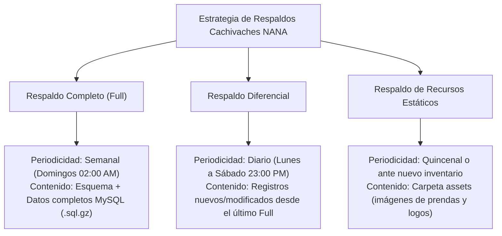

# SERVICIO NACIONAL DE APRENDIZAJE - SENA
## Centro de Formación en Tecnologías de la Información y las Comunicaciones
### Programa: Tecnología en Análisis y Desarrollo de Software (ADSO)

---

# EVIDENCIA DE APRENDIZAJE: GA10-220501097-AA9-EV01
## DOCUMENTACIÓN DE PLAN DE MIGRACIÓN Y RESPALDO DE LOS DATOS DEL SOFTWARE
### Instrumentos y Listas de Chequeo para la Revisión de Modificaciones y Adaptaciones

**Proyecto Formativo:** Plataforma Web de Gestión y Comercialización Multimarca *"Cachivaches NANA"*  
**Código del Proyecto:** ADSO-PROY-NANA-2026  
**Ambiente Origen:** Localhost (Windows 11 / XAMPP / Node.js Express 8080 / Vite 5173 / MySQL `cachivachez_nana_db`)  
**Ambiente Destino:** Servidor Cloud VPS (Linux Ubuntu Server / Docker / Nginx Reverse Proxy / MySQL 8.0 Cloud / SSL)  
**Fecha de Emisión:** Octubre de 2026  
**Versión del Instrumento:** 1.0 — Oficial

---

## 1. INTRODUCCIÓN

En la evolución natural de cualquier solución de software, la transición desde entornos de desarrollo o pruebas hacia arquitecturas productivas en la nube representa una de las fases con mayor riesgo operacional. Los procesos de migración conllevan modificaciones críticas en cadenas de conexión, variables de entorno, seguridad de red, permisos del sistema de archivos y compatibilidad de motores de bases de datos. 

Para garantizar que esta transición se ejecute sin pérdida de información, corrupción de registros transaccionales ni indisponibilidad prolongada del servicio, es indispensable articular un **Plan Integral de Migración y Respaldo de Datos** complementado con **instrumentos técnicos de control y evaluación (listas de chequeo)**.

El presente documento formaliza los protocolos de salvaguarda y traslado para la aplicación web **Cachivaches NANA**, proporcionando los mecanismos estandarizados para verificar cada cambio realizado, validar la integridad de la base de datos MySQL `cachivachez_nana_db` y auditar el comportamiento de los componentes Frontend (Vue 3/Tailwind) y Backend (Node.js/Express) antes, durante y después del despliegue en el nuevo ambiente.

---

## 2. OBJETIVOS

### 2.1. Objetivo General
Diseñar y documentar el plan de migración y la política de respaldo de datos para el sistema web Cachivaches NANA, estructurando listas de chequeo e instrumentos de control que permitan verificar objetivamente las modificaciones y adaptaciones técnicas realizadas durante el proceso.

### 2.2. Objetivos Específicos
* Definir la estrategia y periodicidad de copias de seguridad de la base de datos MySQL y los archivos estáticos del aplicativo, estableciendo los umbrales de RPO (*Recovery Point Objective*) y RTO (*Recovery Time Objective*).
* Delimitar las fases metodológicas para la migración del software desde el entorno local Windows/XAMPP hacia una infraestructura cloud basada en Linux/Docker.
* Construir listas de chequeo exhaustivas para auditar las etapas de pre-migración, ejecución del traslado y post-migración.
* Establecer un protocolo formal de contingencia y marcha atrás (*Rollback*) que garantice la restauración inmediata en caso de anomalías no recuperables.

---

## 3. ALCANCE Y CONTEXTO DEL SISTEMA

### 3.1. Alcance
Este plan abarca la totalidad de los datos y componentes del proyecto **Cachivaches NANA**, incluyendo:
1. **Datos Relacionales:** Estructura (DDL) y registros (DML) de las tablas `usuarios`, `productos` (catálogo de marcas: Oakley, Adidas, Victoria Secret, Puma, Polo, Varios) y `calificaciones` en MySQL.
2. **Lógica de Servidor (Backend):** Servidor Express `server.js`, rutas de API REST (`/servidor_nana/*`), pool de conexiones y variables de configuración.
3. **Capa de Cliente (Frontend):** Paquete compilado de Vue 3 (`dist/`), hoja de estilos Tailwind CSS y almacenamiento en cliente (`localStorage`).
4. **Recursos Multimedia (Assets):** Imágenes de catálogo, logotipos institucionales y gráficos SVG almacenados en disco.

### 3.2. Ficha Técnica de Entornos (Origen vs. Destino)

| Componente | Ambiente Origen (Desarrollo Local) | Ambiente Destino (Producción Cloud) |
|---|---|---|
| **Sistema Operativo** | Windows 11 Pro 64-bit | Ubuntu Server 24.04 LTS 64-bit |
| **Servidor Web / Proxy** | Servidores integrados de desarrollo | Nginx 1.26 + Certificado SSL Let's Encrypt |
| **Backend Runtime** | Node.js v24.x (ejecutado por terminal/cmd) | Node.js v24.x gestionado por PM2 / Docker |
| **Base de Datos** | MariaDB 10.4 / phpMyAdmin (XAMPP :3306) | MySQL 8.0 Community Server / Cloud Managed |
| **Frontend Delivery** | Servidor de desarrollo Vite (:5173) | Archivos estáticos optimizados servidos por Nginx |
| **Protocolo de Red** | HTTP sin cifrar (`http://localhost`) | HTTPS seguro TLS 1.3 (`https://tudominio.com`) |

---

## 4. PLAN DE RESPALDO DE DATOS (BACKUP Y RECUPERACIÓN)

Antes de alterar cualquier configuración o mover paquetes de software, es imperativo garantizar la reproducibilidad y preservación de la información existente.

### 4.1. Estrategia de Respaldo 3-2-1
Se adopta el estándar internacional de respaldo **3-2-1**:
* **3 copias:** 1 copia productiva activa y 2 respaldos independientes.
* **2 medios distintos:** 1 copia en almacenamiento local de respaldo (disco SSD externo) y 1 en almacenamiento en la nube (AWS S3 / Google Drive cifrado).
* **1 copia fuera de sitio (*Off-site*):** Almacenada en una ubicación física o geográfica diferente a la sede de servidores principales.

### 4.2. Métricas de Resiliencia: RPO y RTO
* **RPO (*Recovery Point Objective*):** Máximo de **12 horas**. La pérdida máxima tolerable de datos de transacciones en caso de desastre no superará las 12 horas previas al incidente.
* **RTO (*Recovery Time Objective*):** Máximo de **1 hora**. El tiempo total requerido para restablecer el servicio a partir del respaldo debe ser menor a 60 minutos.

### 4.3. Tipos y Periodicidad de Respaldos



### 4.4. Procedimiento de Generación de Respaldo en MySQL
Comando estandarizado para generar el volcado de la base de datos previo a la migración:
```bash
# Exportar esquema y datos con caracteres UTF-8 íntegros
mysqldump -h localhost -P 3306 -u root -p --default-character-set=utf8mb4 --routines --triggers --single-transaction cachivachez_nana_db > backup_cachivachez_nana_db_pre_migracion.sql

# Comprimir y generar checksum criptográfico de integridad
gzip -9 backup_cachivachez_nana_db_pre_migracion.sql
certutil -hashfile backup_cachivachez_nana_db_pre_migracion.sql.gz SHA256 > hash_verificacion.txt
```

---

## 5. PLAN DE MIGRACIÓN PASO A PASO

El proceso de migración se estructura en 5 fases secuenciales:


1. **Fase 1: Preparación y Auditoría:** Verificación de requisitos en el servidor destino (versiones de Node.js, motor MySQL, puertos abiertos, cortafuegos).
2. **Fase 2: Respaldo y Congelación (*Freeze Window*):** Activación de pantalla de mantenimiento temporal para evitar nuevos registros concurrentes durante la extracción final.
3. **Fase 3: Adaptación y Carga en Destino (ETL):**
   * Creación de la base de datos `cachivachez_nana_db` con cotejamiento `utf8mb4_unicode_ci` en el servidor destino.
   * Importación del script de datos validando claves primarias y registros únicos (`UNIQUE` en `email`).
   * Adaptación de variables en archivo `.env` del backend (host de BD, credenciales seguras, puerto asignado).
   * Compilación del frontend (`npm run build`) apuntando al nuevo dominio de producción mediante HTTPS.
4. **Fase 4: Verificación y Pruebas UAT:** Ejecución de pruebas de humo (*Smoke Testing*) mediante la Lista de Chequeo de Post-Migración.
5. **Fase 5: Conmutación de DNS y Salida en Vivo (*Go-Live*):** Actualización de registros DNS tipo A hacia la nueva IP del servidor cloud y retiro de la pantalla de mantenimiento.

---

## 6. INSTRUMENTOS DE EVALUACIÓN: LISTAS DE CHEQUEO (CHECKLISTS)

Las siguientes listas de chequeo constituyen los instrumentos de auditoría y recolección de información que el equipo técnico debe diligenciar y firmar en cada hito del proceso.

---

### INSTRUMENTO 1: LISTA DE CHEQUEO PRE-MIGRACIÓN Y RESPALDO DE DATOS
* **Objetivo:** Verificar que el entorno origen se encuentre respaldado, estable y listo para la extracción de información.
* **Fecha de Aplicación:** ____________________  
* **Responsable:** Administrador de Base de Datos (DBA) / Ingeniero de DevOps  

| Ítem | Criterio de Verificación | Componente / Evidencia | Estado (C / NC / NA) | Observaciones / Registro de Hallazgo |
|:---:|---|---|:---:|---|
| **1.1** | Se ejecutó el respaldo completo de la base de datos `cachivachez_nana_db`. | Archivo `.sql.gz` generado |  | Validar que incluya tablas `usuarios`, `productos` y `calificaciones`. |
| **1.2** | Se calculó y documentó el hash criptográfico (SHA-256) del respaldo. | Archivo `hash_verificacion.txt` |  | Garantiza que el archivo no sufra corrupción durante la transferencia. |
| **1.3** | Se realizó una prueba de restauración piloto del backup en un ambiente aislado. | BD temporal restaurada |  | Confirmar que los 25 productos de catálogo carguen con precios idénticos. |
| **1.4** | Se respaldaron los archivos multimedia de la carpeta `assets/` (imágenes de prendas y logos). | Carpeta `assets_backup.zip` |  | Verificar presencia de imágenes de todas las marcas (Oakley, Adidas, etc.). |
| **1.5** | Se respaldó el código fuente completo en el repositorio Git con etiqueta de versión (*tag*). | Tag Git: `v1.0.0-pre-migracion` |  | Commit limpio con el estado exacto del código antes de modificar variables. |
| **1.6** | Se definió y comunicó la ventana de mantenimiento a los usuarios y administradores. | Comunicado formal emitido |  | Horario de baja demanda acordado (ventana de 2 horas máx.). |
| **1.7** | Se validó que el servidor destino cumpla con los requisitos mínimos de hardware y software. | CPU $\ge 2$ cores, RAM $\ge 4\text{ GB}$, SSD $\ge 40\text{ GB}$ |  | Servidor Ubuntu Server 24.04 con Node v24 y MySQL 8.0 instalados. |

*Convenciones: **C** = Cumple \| **NC** = No Cumple \| **NA** = No Aplica*

---

### INSTRUMENTO 2: LISTA DE CHEQUEO DURANTE LA EJECUCIÓN Y ADAPTACIONES
* **Objetivo:** Auditar la correcta aplicación de modificaciones técnicas, configuraciones de red y carga de datos en el ambiente de destino.
* **Fecha de Aplicación:** ____________________  
* **Responsable:** Ingeniero Backend / Ingeniero Frontend  

| Ítem | Criterio de Verificación | Componente / Evidencia | Estado (C / NC / NA) | Observaciones / Registro de Hallazgo |
|:---:|---|---|:---:|---|
| **2.1** | Creación exitosa de la base de datos `cachivachez_nana_db` en el motor de producción. | Codificación: `utf8mb4_unicode_ci` |  | Soporte nativo para tildes, caracteres especiales y emojis en comentarios. |
| **2.2** | Importación completa del volcado SQL sin errores de sintaxis ni truncamiento. | Log de importación de MySQL |  | Confirmar conteo exacto de registros en tablas principales. |
| **2.3** | Creación de usuario exclusivo de base de datos con privilegios restringidos (principio de menor privilegio). | Usuario no-root con contraseña fuerte |  | Usuario `nana_app_user` limitado a DML (SELECT, INSERT, UPDATE, DELETE). |
| **2.4** | Configuración de variables de entorno en archivo protegido `.env` en el servidor backend. | Variables: `DB_HOST`, `DB_USER`, `DB_PASS`, `PORT` |  | Evitar almacenamiento de credenciales en texto plano dentro de `server.js`. |
| **2.5** | Adaptación de rutas de endpoints de API en el Frontend compilado. | URL base apuntando al nuevo dominio/proxy |  | Reemplazo de llamadas a `http://localhost:8080` por ruta relativa `/api` o HTTPS. |
| **2.6** | Configuración del Pool de conexiones MySQL en `server.js` para alta concurrencia. | Parámetros: `connectionLimit: 25`, `queueLimit: 0` |  | Prevenir saturación de hilos ante picos de compras concurrentes. |
| **2.7** | Configuración del servidor inverso Nginx con encabezados de seguridad HTTP. | Headers: `X-Frame-Options`, `Content-Security-Policy` |  | Protección contra clickjacking y ataques de inyección. |
| **2.8** | Instalación y validación del certificado de seguridad SSL/TLS (HTTPS). | Certificado SSL Let's Encrypt vigente |  | Cifrado de extremo a extremo en tráfico de contraseñas y pagos. |

*Convenciones: **C** = Cumple \| **NC** = No Cumple \| **NA** = No Aplica*

---

### INSTRUMENTO 3: LISTA DE CHEQUEO POST-MIGRACIÓN (INTEGRIDAD Y PRUEBAS UAT)
* **Objetivo:** Certificar la integridad funcional, consistencia de datos y rendimiento de la tienda en el ambiente productivo final.
* **Fecha de Aplicación:** ____________________  
* **Responsable:** Ingeniero de Calidad (QA) / Líder del Proyecto  

| Ítem | Criterio de Verificación | Componente / Prueba | Estado (C / NC / NA) | Observaciones / Registro de Hallazgo |
|:---:|---|---|:---:|---|
| **3.1** | **Integridad de Catálogo:** Se muestran las 6 marcas con sus productos exactos. | Módulo Productos (`nana_productos.vue`) |  | Oakley (5), Adidas (4), Victoria Secret (4), Puma (4), Polo (4), Varios (4). |
| **3.2** | **Carga de Imágenes:** Ninguna prenda presenta icono de imagen rota en catálogo ni en carrito. | Renderizado de imágenes (``) |  | Las imágenes locales cargan desde el nuevo CDN/webroot sin errores 404. |
| **3.3** | **Filtrado y Búsqueda:** Los botones de marca y la caja de texto filtran en tiempo real. | Filtros de marca y buscador |  | Comprobar búsqueda textual (ej. "chaqueta", "gorra", "splash"). |
| **3.4** | **Autenticación:** El inicio de sesión funciona con usuarios preexistentes de la base de datos. | Login (`/servidor_nana/login`) |  | Probar login con credenciales válidas e inválidas. |
| **3.5** | **Registro de Nuevos Clientes:** Se insertan nuevos registros validando unicidad de correo y cédula. | Registro (`nana_registro.vue`) |  | Confirmar que el código HTTP 409 se active ante intento de correo duplicado. |
| **3.6** | **Cierre de Sesión Seguro:** Salir borra los datos de usuario de memoria y `localStorage`. | Botón "Cerrar Sesión" |  | Validar que al volver a inicio los campos de correo y contraseña estén limpios. |
| **3.7** | **Flujo del Carrito:** Agregar prendas, modificar cantidades y totalizar calcula correctamente. | Carrito de Compras (`nana_carrito.vue`) |  | Subtotal + $15.000 de envío calculados con precisión monetaria. |
| **3.8** | **Pasarela de Pago:** Confirmación por Contraentrega y subida de comprobante por Transferencia. | Pasarela de Pago (`nana_pagos.vue`) |  | Precios sin caracteres de escape (`$190.000` visible sin barras invertidas). |
| **3.9** | **Panel de Administración:** Control de inventario y consulta de usuarios en BD operativos. | Panel Admin (`nana_admin.vue`) |  | Capacidad de crear y remover prendas asignando sus marcas oficiales. |
| **3.10** | **Módulo de Reseñas:** Guardado y lectura de opiniones con estrellas en base de datos. | Calificaciones (`nana_calificaciones.vue`) |  | Inserción de nueva opinión y visualización inmediata en el listado. |
| **3.11** | **Navegación Barra Superior:** Enlaces Inicio, Productos, Acerca de nosotros, Opiniones y Admin. | Barra de navegación (`App.vue`) |  | Todos los botones interactúan fluidamente cambiando de pantalla. |

*Convenciones: **C** = Cumple \| **NC** = No Cumple \| **NA** = No Aplica*

---

### INSTRUMENTO 4: MATRIZ DE CONTROL DE ADAPTACIONES Y CAMBIOS TÉCNICOS
* **Objetivo:** Registrar formalmente las modificaciones efectuadas en el código fuente para adaptarse al nuevo ambiente.

| ID Adaptación | Archivo Modificado | Descripción del Cambio Realizado | Justificación Técnica | Responsable |
|:---:|---|---|---|---|
| **ADAP-01** | `servidor_nana/server.js` | Sustitución de `mysql.createConnection` por `mysql.createPool`. | Garantizar auto-reconexión ante desconexiones o suspensión de sockets en la nube. | Dev Backend |
| **ADAP-02** | `servidor_nana/server.js` | Parametrización de credenciales mediante `process.env`. | Cumplir estándar de seguridad de 12-Factor App sin exponer contraseñas en Git. | DevOps |
| **ADAP-03** | `nanainicio/src/App.vue` | Limpieza explícita de variables reactivas al cerrar sesión. | Evitar persistencia indebida de credenciales del último usuario en pantalla. | Dev Frontend |
| **ADAP-04** | `nana_productos.vue` | Implementación de botones de filtrado multimarca y fallback de imágenes. | Cumplir requerimiento funcional de consulta por marcas sin errores visuales 404. | Dev Frontend |
| **ADAP-05** | `nana_carrito.vue` | Reemplazo de clase rota `class="..."` por clases completas de Tailwind. | Restablecer la operatividad y estética del botón de avance hacia la pasarela de pagos. | Dev Frontend |
| **ADAP-06** | `nana_pagos.vue` | Remoción de barras invertidas en cadenas de precios (`\$` $\rightarrow$ `$`). | Corrección cosmética para visualización profesional de moneda colombiana. | Dev Frontend |

---

## 7. PROTOCOLO DE CONTINGENCIA Y MARCHA ATRÁS (*ROLLBACK PLAN*)

Si durante el proceso de migración o en la etapa de pruebas post-migración se detecta una inconsistencia crítica que impida la operación (ej. corrupción irrecuperable de datos, fallo severo en la pasarela o latencia de red inaceptable), se activará de inmediato el **Plan de Marcha Atrás**:

```
TIEMPO LÍMITE DE DECISIÓN DE ROLLBACK: 45 MINUTOS TRAS EL INICIO DE LA MIGRACIÓN
```

### Pasos de Ejecución del Rollback:
1. **Paso 1: Cancelación Inmediata de Migración:** Detener los servicios en el servidor destino (`pm2 stop server` / `docker-compose down`).
2. **Paso 2: Reversión de Tráfico de Red (DNS):** Reconfigurar los registros DNS o la regla del proxy inverso para apuntar nuevamente a la IP del servidor origen estable.
3. **Paso 3: Restauración de Base de Datos Origen:** Reinyectar el volcado de respaldo generado en el Instrumento 1 (`backup_cachivachez_nana_db_pre_migracion.sql.gz`) en caso de haber sufrido alteraciones.
4. **Paso 4: Levantamiento de Entorno Estable:** Reanudar los procesos locales o del servidor base ejecutando [INICIAR_PROYECTO.bat](file:///C:/Users/User/Documents/SENA%20TECNOLOGIA/proyecto/INICIAR_PROYECTO.bat).
5. **Paso 5: Notificación e Informe de Incidencia:** Comunicar al equipo y partes interesadas el retorno al estado anterior y convocar a sesión técnica para analizar las causas raíz a partir de las listas de chequeo no conformes.

---

## 8. CONCLUSIONES

1. **Estandarización y Reducción del Error Humano:** La implementación de listas de chequeo estructuradas transforma una actividad compleja y riesgosa como la migración en un procedimiento reproducible, verificable paso a paso por distintos miembros del equipo.
2. **Salvaguarda de los Activos de Información:** La adopción del modelo de respaldo 3-2-1 con pruebas de restauración previas garantiza que, aún ante un fallo catastrófico en la infraestructura cloud de destino, el inventario de 25 prendas y la base de datos de usuarios de Cachivaches NANA permanecerán 100% protegidos.
3. **Trazabilidad Completa del Cambio:** La matriz de adaptaciones técnicas documenta cada línea de código modificada, garantizando que el mantenimiento futuro de la aplicación cuente con un historial técnico transparente alineado a los estándares de formación del SENA.

---

## 9. FUENTES BIBLIOGRÁFICAS Y REFERENCIAS

* **ISO/IEC. (2006).** *ISO/IEC 14764:2006 - Software Engineering — Software Life Cycle Processes — Maintenance*. International Organization for Standardization / International Electrotechnical Commission.
* **ISO/IEC. (2011).** *ISO/IEC 25010: Systems and software engineering — Systems and software Quality Requirements and Evaluation (SQuaRE) — System and software quality models*.
* **SENA. (2024).** *Material de Formación: Mantenimiento de software y migración de aplicaciones*. Programa Tecnología en Análisis y Desarrollo de Software (ADSO).
* **Pressman, R. S., & Maxim, B. R. (2020).** *Ingeniería del Software: Un Enfoque Práctico* (9.ª ed.). McGraw-Hill Education.
* **Sommerville, I. (2019).** *Ingeniería de Software* (10.ª ed.). Pearson Educación.
* **MySQL Documentation Team. (2024).** *MySQL 8.0 Reference Manual: Backup and Recovery Strategies*. Oracle Corporation. https://dev.mysql.com/doc/refman/8.0/en/backup-and-recovery.html
* **The Twelve-Factor App. (2023).** *Config: Store config in the environment*. https://12factor.net/config
